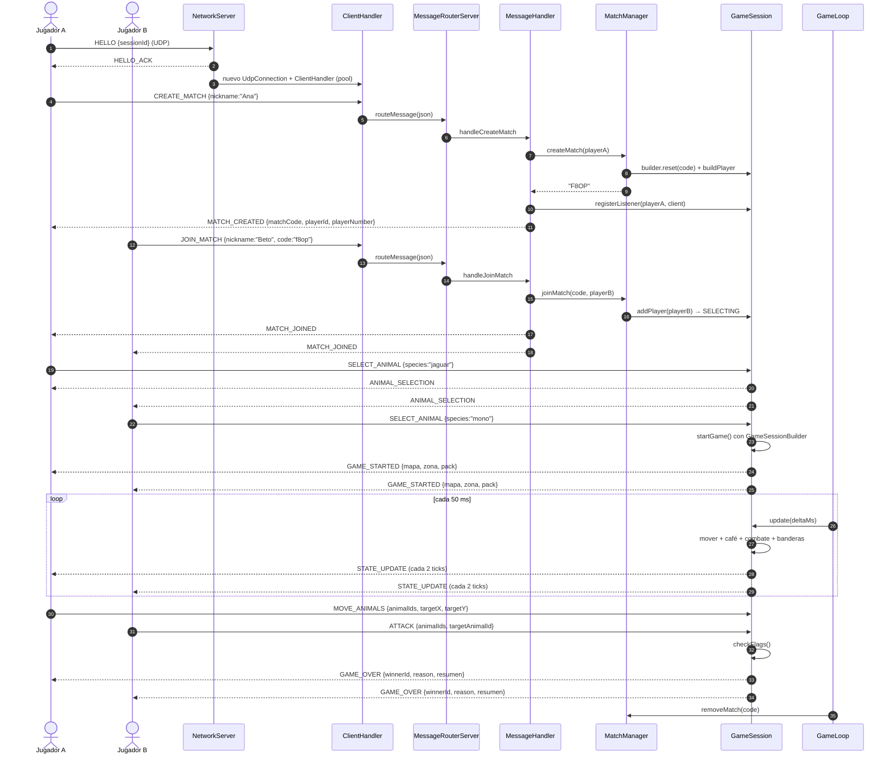
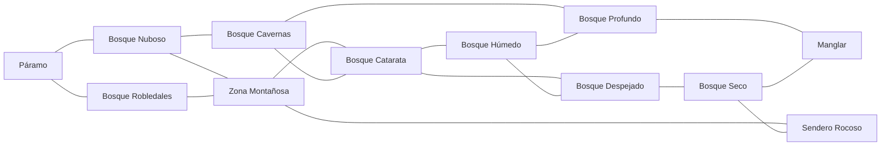

# Jungle Attack — Servidor

Servidor autoritativo del juego **Jungle Attack** para el Caso 2 de Programación Orientada a Objetos.

El servidor recibe datagramas **UDP confiables** de dos clientes, administra N partidas simultáneas, valida todas las reglas del juego y envía a cada jugador únicamente la información que tiene permitido ver. El cliente nunca calcula reglas: solo envía intenciones (`MOVE_ANIMALS`, `ATTACK`, etc.) y dibuja lo que el servidor le responde.

> **Estado actual:** compila, empaqueta y **127 pruebas unitarias/de integración pasan**.
>
> ```text
> Tests run: 127, Failures: 0, Errors: 0, Skipped: 0
> BUILD SUCCESS
> ```

---

## 1. Alcance

Este repositorio contiene **solo el servidor**. El cliente vive en el repositorio aparte `Client/` y respeta el mismo transporte UDP confiable y el protocolo JSON descrito en la sección 8.

Incluye:

- Lobby con creación/unión de partidas mediante código de 4 caracteres.
- Selección de especie entre 7 animales nativos de Costa Rica.
- 5 bots, uno por cada especie que no eligió ningún jugador.
- Mapa de 12 zonas conectadas por caminos y rutas calculadas con BFS.
- Niebla de guerra aplicada en el servidor.
- Movimiento con velocidad constante.
- Combate con enfriamiento de 1 ataque por segundo por animal.
- 10 tazas de café, daño acumulativo y bonus de energía por bots eliminados.
- Victoria al tocar la bandera rival.
- N partidas simultáneas, cada una aislada.
- Protocolo JSON de un mensaje por datagrama UDP.
- Maven, JUnit 5 y GitHub Actions.
- Constantes centralizadas, herencia, polimorfismo y patrones de diseño.

---

## 2. Requisitos y ejecución

### Requisitos

- **JDK 17** o superior (el `pom.xml` compila con `release 17`).
- **Maven 3.9+**.
- No se necesita instalar Gson ni JUnit: Maven los descarga.

### Compilar y probar

```bash
cd Server
mvn -B test
```

### Generar el JAR ejecutable

```bash
mvn -B package
```

El plugin Shade genera un único archivo:

```text
target/jungle-attack-server.jar
```

### Ejecutar

```bash
java -jar target/jungle-attack-server.jar          # puerto 8080
java -jar target/jungle-attack-server.jar 9090     # puerto indicado como argumento
java -Dserver.port=9090 -jar target/jungle-attack-server.jar
```

Orden de prioridad del puerto:

1. Primer argumento de la línea de comandos.
2. Propiedad del sistema `server.port`.
3. `IConstants.DEFAULT_SERVER_PORT` (`8080`).

Al arrancar se imprime:

```text
Servidor UDP escuchando en el puerto 8080
Jungle Attack server listo. Presiona Ctrl+C para detenerlo.
```

El hilo de recepción UDP **no es daemon**, por eso la JVM sigue viva después de que `main` termina. `Ctrl+C` ejecuta el *shutdown hook* y detiene el `GameLoop` y el `NetworkServer`.

### Prueba de humo desde PowerShell

Con el servidor corriendo en el puerto 9090, este script hace el `HELLO` y envía `CREATE_MATCH`:

```powershell
$udp = New-Object System.Net.Sockets.UdpClient
$udp.Connect("127.0.0.1", 9090)
$udp.Client.ReceiveTimeout = 5000

function Send-Udp([byte]$type, [int]$seq, [byte[]]$payload) {
    $bytes = New-Object byte[] (12 + $payload.Length)
    $bytes[0] = 0x4A; $bytes[1] = 0x41; $bytes[2] = 1; $bytes[3] = $type
    $seqBytes = [BitConverter]::GetBytes($seq); [Array]::Reverse($seqBytes)
    $ackBytes = [BitConverter]::GetBytes(0); [Array]::Reverse($ackBytes)
    $seqBytes.CopyTo($bytes, 4); $ackBytes.CopyTo($bytes, 8)
    $payload.CopyTo($bytes, 12)
    [void]$udp.Send($bytes, $bytes.Length)
}

Send-Udp 3 0 ([BitConverter]::GetBytes([long](Get-Random)))   # HELLO

$endpoint = New-Object System.Net.IPEndPoint ([System.Net.IPAddress]::Any), 0
$reply = $udp.Receive([ref]$endpoint)                         # HELLO_ACK (tipo 4)

$json = [Text.Encoding]::UTF8.GetBytes('{"type":"CREATE_MATCH","payload":{"nickname":"Ana"}}')
Send-Udp 1 0 $json

do {
    $reply = $udp.Receive([ref]$endpoint)                     # ignorar ACK (tipo 2)
} while ($reply[3] -ne 1)

[Text.Encoding]::UTF8.GetString($reply, 12, $reply.Length - 12)
$udp.Close()
```

Respuesta esperada (el código y el id cambian):

```json
{"type":"MATCH_CREATED","payload":{"matchCode":"F8OP","playerId":"P-3857db57-...","playerName":"Ana","playerNumber":1}}
```

### Jugar con el rival en otra red (Tailscale)

El servidor ya escucha en todas las interfaces, así que el único problema es
que Internet normalmente no enruta hasta una PC doméstica. La forma más simple
de resolverlo es una red privada virtual tipo malla: **Tailscale**. No hay que
abrir puertos en el router, funciona detrás de CGNAT y no cambia el código.

**Una sola vez, en las dos computadoras:**

1. Instalar Tailscale desde <https://tailscale.com/download> e iniciar sesión.
   Lo más simple para una partida es que ambas PCs usen la **misma cuenta**;
   así quedan en la misma red privada. (Alternativa: invitar al otro jugador
   al *tailnet* desde el panel de Tailscale.)
2. Comprobar que se ven entre sí: `tailscale status` debe listar la otra PC.

**En la computadora que hace de servidor:**

```powershell
# 1. Obtener la IP de Tailscale (100.x.y.z)
tailscale ip -4

# 2. Permitir UDP 8080 en el Firewall de Windows (PowerShell como administrador)
New-NetFirewallRule -DisplayName "Jungle Attack UDP 8080" `
  -Direction Inbound -Protocol UDP -LocalPort 8080 -Action Allow

# 3. Arrancar el servidor
java -jar target\jungle-attack-server.jar 8080
```

**En las dos computadoras (cada jugador):**

```powershell
java -jar jungle-attack-client.jar
```

En el lobby, el campo **Servidor** lleva la IP de Tailscale de la máquina
servidor (`100.x.y.z`) y **Puerto** vale `8080`. El jugador del servidor puede
usar `localhost`, pero es más claro usar también la IP de Tailscale.

Luego uno pulsa **Crear partida** y el otro escribe el código de 4 caracteres
y pulsa **Unirse**.

Notas:

- Solo **una** computadora ejecuta el servidor. La otra solo ejecuta el cliente
  y únicamente necesita `jungle-attack-client.jar` (no el repositorio del
  servidor).
- Cada jugador necesita su propia copia del JAR del cliente; la ruta de la
  carpeta no tiene que coincidir entre computadoras.
- Si `tailscale status` no muestra la otra PC, revisa que Tailscale esté
  conectado en ambas y con la misma cuenta.
- Si el cliente se queda esperando o da *timeout*, casi siempre es el firewall
  del servidor o una IP/puerto equivocados. Prueba antes `ping 100.x.y.z`.

### Alternativa: playit.gg (sin VPN)

Si no quieren instalar Tailscale, `playit.gg` publica el puerto UDP a través de
un relé, sin abrir puertos en el router. Solo la PC servidor ejecuta el agente.

1. Crear cuenta en <https://playit.gg> y descargar el agente para Windows desde
   <https://playit.gg/download>.
2. Ejecutar el agente y abrir el enlace de *claim* que muestra; iniciar sesión
   para vincularlo a la cuenta.
3. En el panel: **Tunnels → Add Tunnel → UDP** (el túnel UDP es gratis;
   *TCP+UDP* requiere Premium y no hace falta).
4. Configurar el túnel:
   - **Local address:** `127.0.0.1`
   - **Local port:** `8080`
   - **Port count:** `1`
5. Crear el túnel y copiar la **Allocation**: un dominio tipo `algo.ply.gg` y
   un puerto externo (por ejemplo `51795`). Ese puerto **no** es 8080.
6. Arrancar el servidor en `8080` y dejar el agente abierto.
7. En los dos clientes: **Servidor** = el dominio de playit y **Puerto** = el
   puerto externo de la Allocation.

Ventaja: no hay que tocar el firewall. Desventaja: el tráfico pasa por un relé
de playit, así que la latencia es algo mayor que con Tailscale.

---

## 3. Arquitectura

### 3.1 “P2P” significa jugador contra jugador

El enunciado usa “P2P”, pero la aclaración técnica indica que la arquitectura real es **cliente-servidor**:

- Los dos clientes **nunca** se conectan entre sí.
- Todo mensaje pasa por el servidor.
- El servidor es la **autoridad**: valida movimiento, combate, café, bonus y victoria.
- La niebla de guerra se filtra en el servidor, no en el cliente.

Esto evita trampas y mantiene a ambos clientes consistentes.

### 3.2 Hilos

| Hilo | Responsabilidad |
|---|---|
| `main` | Ensambla `MatchManager`, `MessageHandler`, `GameLoop` y `NetworkServer`; luego termina. |
| `game-loop` (daemon) | Cada 50 ms calcula el delta real con `System.nanoTime()` y actualiza todas las partidas. |
| `udp-receive` (no daemon) | Recibe todos los datagramas y los reparte entre las conexiones; mantiene viva la JVM. |
| `housekeeping` | Cada 50 ms reenvía lo no confirmado y cierra sesiones inactivas. |
| Pool de clientes | Un `ClientHandler` por cliente; espera mensajes del `UdpConnection` sin bloquear a los demás. |

Concurrencia:

- `MatchManager` usa `ConcurrentHashMap<String, GameSession>`.
- Los métodos de `GameSession` que tocan estado están `synchronized`.
- `ClientHandler.sendMessage` está `synchronized` porque escriben tanto el hilo del cliente como el `GameLoop`.
- `ReliableUdpChannel` protege secuencias, ACK, pendientes y buffer de reensamblado con un lock.
- Los métodos `start/stop` usan banderas `volatile`.

### 3.3 Paquetes

| Paquete | Contenido | Rol |
|---|---|---|
| `constants` | `IConstants` | Todos los valores fijos del juego y del protocolo. |
| `common.model` | `BaseAnimal`, `BaseZone`, `Point2D`, `Species` | Modelo compartido con el futuro cliente. |
| `common.message` | `Message`, `MessageType` | Sobre JSON y catálogo de tipos de mensaje. |
| `common.util` | `TimeSource` | Reloj inyectable para pruebas deterministas. |
| `server.model` | `Animal`, `Pack`, `Participant`, `Player`, `Bot`, `Zone`, `Flag`, `CoffeeCup`, `AttackOrder`, `GameState` | Estado del servidor. |
| `server.logic` | `GameSession`, `GameSessionBuilder`, `MatchManager`, `MapManager`, `CombatManager`, `VisibilityService`, `SnapshotBuilder`, `GameLoop`, fábricas, `GameListener` | Reglas y coordinación. |
| `server.network` | `NetworkServer`, `ClientChannel`, `ClientHandler`, `MessageRouterServer`, `MessageHandler` | Recepción UDP, enrutamiento y adaptación al transporte. |
| `server.network.udp` | `UdpProtocol`, `ReliableUdpChannel`, `UdpConnection` | Framing, confiabilidad, handshake y sesión por cliente. |
| `server` | `ServerMain` | Punto de entrada. |

### 3.4 Separación de responsabilidades

```text
ServerMain
 ├── GameLoop ──────────────► MatchManager ──► GameSession
 ├── NetworkServer            (Singleton)         ├── MapManager
 │    └── ClientHandler ──► MessageRouterServer   ├── CombatManager
 │             │                 └── MessageHandler├── VisibilityService
 │             │                          │        └── SnapshotBuilder
 │             └── implementa GameListener ┘
 └── Shutdown hook
```

- `GameSession` **no conoce sockets**. Solo conoce `GameListener`.
- `ClientHandler` implementa `GameListener`; así la lógica puede enviar mensajes sin depender de la red.
- `MapManager` es el único que conoce la topología y el BFS.
- `CombatManager` es el único que resuelve daño, enfriamientos y muertes.
- `VisibilityService` es el único que decide qué ve un jugador.
- `SnapshotBuilder` construye los JSON que no son un simple `STATE_UPDATE`.

---

## 4. Diagrama de clases

```mermaid
classDiagram
    direction LR

    namespace common_model {
        class BaseAnimal {
            <<abstract>>
            -int id
            -String species
            -int currentEnergy
            -double x
            -double y
            +getPosition() Point2D
        }
        class BaseZone {
            <<abstract>>
            -String zoneId
            -boolean hasFlag
        }
        class Point2D
        class Species {
            <<enumeration>>
            PEREZOSO
            MONO
            TUCAN
            RANA_ROJA
            JAGUAR
            DANTA
            BOA_CONSTRICTORA
        }
    }

    namespace constants {
        class IConstants {
            <<interface>>
        }
    }

    namespace server_model {
        class Animal {
            -Pack pack
            -List~Point2D~ route
            -int routeIndex
            -double targetX
            -double targetY
            -String zoneId
            -long lastAttackTime
            -boolean hasAttacked
            +takeDamage(int)
            +heal(int)
            +isDefeated() boolean
            +canAttack(long) boolean
            +markAttack(long)
            +movePosition(double)
            +setRoute(List~Point2D~, double, double)
            +clearRoute()
        }
        class Pack {
            -String packId
            -String species
            -boolean botPack
            -List~Animal~ animals
            -int damageCapacity
            -int botsKilled
            -int coffeeCupsCollected
            +increaseDamage()
            +registerCoffeeCup()
            +registerKill(Pack) boolean
            +applyEnergyBonus()
            +getLivingAnimals() List~Animal~
            +isDefeated() boolean
        }
        class Participant {
            <<abstract>>
            -String participantId
            -String name
            -Pack pack
            -Zone currentZone
            -boolean connected
            +isBot() boolean
        }
        class Player {
            -String selectedSpecies
            -String viewedZoneId
            -String flagColor
            +selectSpecies(String) boolean
            +hasSelectedSpecies() boolean
            +isValidNickname(String) boolean
        }
        class Bot {
            -Animal targetCandidate
            +updateAI(GameSession, double)
            +searchTargets(GameSession)
            +autoMove(GameSession)
        }
        class Zone {
            -String displayName
            -String imageName
            -double x
            -double y
            -double width
            -double height
            -List~Zone~ adjacentNodes
            -List~Animal~ entitiesInside
            -List~CoffeeCup~ cupsInside
            -Flag flag
            +connect(Zone)
            +contains(double, double) boolean
            +getCenter() Point2D
            +randomPointInside(Random, double) Point2D
        }
        class Flag {
            -String flagId
            -String ownerId
            -String color
            -String zoneId
            -double x
            -double y
        }
        class CoffeeCup {
            -String cupId
            -String zoneId
            -double x
            -double y
            -boolean consumed
            +consume()
        }
        class AttackOrder {
            -List~Animal~ attackers
            -Animal target
            +isActive() boolean
        }
        class GameState {
            -String matchCode
            -String playerName
            -int matchDurationSeconds
            -String opponentName
            -Zone viewedZone
            -List~Zone~ availableZones
            -List~Animal~ visibleAnimals
            -List~CoffeeCup~ visibleCups
            -Pack myPack
            -boolean gameOver
            -boolean playerWon
            +toJson() JsonObject
        }
    }

    namespace server_logic {
        class IParticipantFactory {
            <<interface>>
            +createParticipant(String, String) Participant
            +createPack(String, String) Pack
            +createAnimals(Pack, int) List~Animal~
        }
        class PlayerFactory
        class BotFactory
        class GameSessionBuilder {
            -Random random
            -TimeSource clock
            -GameSession session
            +reset(String)
            +reset(GameSession)
            +buildPlayer(Player)
            +buildPlayers(Player, Player)
            +buildMap(MapManager)
            +buildPlayerPacks(IParticipantFactory)
            +buildBots(IParticipantFactory)
            +buildCombatManager(CombatManager)
            +buildStartingZones()
            +buildItems()
            +getResult() GameSession
        }
        class MatchManager {
            -MatchManager instance
            -ConcurrentHashMap~String, GameSession~ activeMatches
            -MatchCodeGenerator codeGenerator
            +getInstance() MatchManager
            +createMatch(Player) String
            +joinMatch(String, Player) GameSession
            +removeMatch(String)
            +handleDisconnect(GameSession, Player)
            +snapshotMatches() Collection~GameSession~
        }
        class MatchCodeGenerator {
            +generate() String
            +generateUnique(Set~String~) String
        }
        class GameSession {
            -String matchCode
            -Phase phase
            -List~Player~ players
            -List~Bot~ bots
            -MapManager mapManager
            -CombatManager combatManager
            -VisibilityService visibilityService
            -SnapshotBuilder snapshotBuilder
            -Map~String, GameListener~ listeners
            -Map~String, AttackOrder~ attackOrders
            -long matchDurationMs
            -long tickCounter
            -boolean gameOver
            +addPlayer(Player)
            +selectSpecies(Player, String)
            +startGame()
            +update(int)
            +commandMove(Player, List~Integer~, double, double)
            +commandAttack(Player, List~Integer~, int)
            +viewZone(Player, String)
            +handleDisconnect(Player)
            +registerListener(String, GameListener)
            +sendToPlayer(String, String, JsonObject)
        }
        class MapManager {
            -Map~String, Zone~ worldMap
            +getZone(String) Zone
            +getZones() Collection~Zone~
            +findZoneAt(double, double) Zone
            +calculateRouteBFS(Zone, Zone) List~Zone~
            +commandMove(Animal, double, double) boolean
            +assignStartingZones(List~Participant~, Random)
            +spawnItems(List~Player~, Random)
            +findFlagOf(String) Flag
            +transferEntity(Animal, Zone, Zone)
        }
        class CombatManager {
            +processCombat(GameSession)
            +executeAttack(Animal, Animal, Pack)
            +validateDeath(Animal)
        }
        class VisibilityService {
            +buildState(GameSession, Player) GameState
            +zonesWithLivingAnimals(GameSession, Player) List~Zone~
        }
        class SnapshotBuilder {
            +matchJoined(GameSession, Player) JsonObject
            +animalSelection(GameSession, Player) JsonObject
            +gameStarted(GameSession, Player) JsonObject
            +gameOver(GameSession) JsonObject
        }
        class GameLoop {
            -boolean running
            -int tickRateMs
            -long lastTickNanos
            +start()
            +stop()
            +updateMatches(int)
        }
        class GameListener {
            <<interface>>
            +onGameMessage(String, JsonObject)
        }
        class MatchException
    }

    namespace server_network {
        class NetworkServer {
            -DatagramSocket socket
            -ExecutorService clientPool
            -Thread receiveThread
            -Map~InetSocketAddress,UdpConnection~ connections
            +startServer(int)
            +stop()
        }
        class ClientChannel {
            <<interface>>
            +receive() String
            +send(String) boolean
            +close()
            +remoteAddress() String
        }
        class ClientHandler {
            -ClientChannel channel
            -Player player
            -GameSession session
            +run()
            +sendMessage(String, JsonObject)
            +sendError(String)
            +attach(Player, GameSession)
        }
        class MessageRouterServer {
            -MessageHandler handler
            +routeMessage(ClientHandler, String)
            +onDisconnect(ClientHandler)
        }
        class MessageHandler {
            +handleCreateMatch(ClientHandler, Message)
            +handleJoinMatch(ClientHandler, Message)
            +handleSelectAnimal(ClientHandler, Message)
            +handleMoveAnimals(ClientHandler, Message)
            +handleAttack(ClientHandler, Message)
            +handleViewZone(ClientHandler, Message)
            +handleDisconnect(ClientHandler)
        }
    }

    namespace server_network_udp {
        class UdpProtocol {
            <<utility>>
            +encode(byte, int, int, byte[]) byte[]
            +decode(byte[], int) Packet
        }
        class ReliableUdpChannel {
            -Map~int,Pending~ pending
            -TreeMap~int,String~ future
            +send(String) boolean
            +onPacket(Packet, long)
            +tick(long)
            +close()
        }
        class UdpConnection {
            -InetSocketAddress remote
            -long sessionId
            -ReliableUdpChannel channel
            +receive() String
            +send(String) boolean
            +close()
        }
    }

    namespace common_message {
        class Message {
            -String type
            -JsonObject payload
            +toJson() String
            +fromJson(String) Message
        }
        class MessageType {
            <<utility>>
        }
    }

    namespace boot {
        class ServerMain
    }

    Animal --|> BaseAnimal
    Zone --|> BaseZone
    Player --|> Participant
    Bot --|> Participant

    Participant --> Pack : pack
    Pack "1" o-- "*" Animal : animals
    Zone "1" o-- "*" Animal : entitiesInside
    Zone "1" o-- "*" CoffeeCup : cupsInside
    Zone --> "0..1" Flag : flag
    Zone --> "*" Zone : caminos

    GameSession "1" *-- "2" Player
    GameSession "1" *-- "5" Bot
    GameSession --> MapManager
    GameSession --> CombatManager
    GameSession --> VisibilityService
    GameSession --> SnapshotBuilder
    GameSession --> "*" AttackOrder
    GameSession --> "*" GameListener
    GameSession ..> GameState : construye

    PlayerFactory ..|> IParticipantFactory
    BotFactory ..|> IParticipantFactory
    GameSessionBuilder ..> PlayerFactory
    GameSessionBuilder ..> BotFactory
    GameSessionBuilder ..> GameSession : construye

    MatchManager --> MatchCodeGenerator
    MatchManager --> GameSessionBuilder
    MatchManager "1" o-- "*" GameSession : activas
    GameLoop --> MatchManager
    GameLoop ..> GameSession : update()

    ClientHandler ..|> GameListener
    ClientHandler --> ClientChannel
    ClientHandler --> MessageRouterServer
    MessageRouterServer --> MessageHandler
    MessageHandler --> MatchManager
    MessageHandler --> GameSession
    MessageRouterServer ..> Message
    Message ..> MessageType

    NetworkServer --> "*" UdpConnection
    UdpConnection ..|> ClientChannel
    UdpConnection --> ReliableUdpChannel
    ReliableUdpChannel --> UdpProtocol

    ServerMain --> MatchManager
    ServerMain --> GameLoop
    ServerMain --> NetworkServer
```



---

## 5. Diagrama de secuencia

Flujo completo: crear partida, unirse, elegir especie, jugar y terminar.



> En el diagrama, las órdenes de juego llegan a `GameSession` a través de `ClientHandler → MessageRouterServer → MessageHandler`. Se simplificó esa cadena después del lobby para que el diagrama sea legible.

---

## 6. Patrones de diseño y POO

### 6.1 Patrones exigidos

| Patrón | Dónde | Para qué |
|---|---|---|
| **Singleton** | `MatchManager` | Una sola instancia administra todas las partidas activas. Constructor privado, `getInstance()` sincronizado y `ConcurrentHashMap`. |
| **Abstract Factory** | `IParticipantFactory`, `PlayerFactory`, `BotFactory` | Crear familias completas (`Participant`, `Pack`, `Animal`) con estadísticas distintas sin que `GameSession` dependa de clases concretas. |
| **Builder** | `GameSessionBuilder` | Construir una partida paso a paso: mapa, packs, bots, combate, zonas, ítems. Evita un constructor gigante. |
| **Observer** | `GameListener` + `GameSession.listeners` | La lógica notifica mensajes sin conocer sockets. `ClientHandler` es el observador real. |
| **Facade / delegación** | `GameSession` | Coordina `MapManager`, `CombatManager`, `VisibilityService` y `SnapshotBuilder`; cada módulo tiene una responsabilidad. |

### 6.2 Herencia y polimorfismo

| Relación | Uso |
|---|---|
| `Animal extends BaseAnimal` | Reutiliza id, especie, energía y posición; agrega ruta, zona, cooldown y combate. |
| `Zone extends BaseZone` | Reutiliza id y `hasFlag`; agrega geometría, caminos, animales, tazas y bandera. |
| `Player extends Participant` | Implementa `isBot() == false`; agrega especie, vista y color de bandera. |
| `Bot extends Participant` | Implementa `isBot() == true`; agrega IA de patrulla y persecución. |
| `GameListener` | Interfaz implementada por `ClientHandler` y por dobles de prueba. |
| `IParticipantFactory` | Interfaz implementada por `PlayerFactory` y `BotFactory`. |

El código que necesita distinguir participantes usa `participant.isBot()` o `pack.isBotPack()`, no `instanceof`.

### 6.3 Otros recursos de diseño

- **Enum** `Species`: las 7 especies y sus ids.
- **Enum interno** `GameSession.Phase`: `WAITING`, `SELECTING`, `RUNNING`, `FINISHED`.
- **Value Object** `Point2D`: posiciones inmutables.
- **Inyección de dependencias**: `Random` y `TimeSource` se pasan por constructor para pruebas deterministas.
- **Constantes centralizadas**: `IConstants` evita números mágicos.

---

## 7. Reglas implementadas

### 7.1 Constantes principales

| Constante | Valor | Significado |
|---|---:|---|
| `INITIAL_ENERGY_PLAYER` | 20 | Energía inicial de cada animal de jugador. |
| `INITIAL_ENERGY_BOT` | 10 | Energía inicial de cada animal bot. |
| `MAX_ENERGY` | 20 | Tope de energía al curar. |
| `INITIAL_DAMAGE_PLAYER` | 2 | Daño inicial del pack de jugador. |
| `INITIAL_DAMAGE_BOT` | 1 | Daño del pack bot. |
| `MAX_DAMAGE_CAPACITY_PLAYER` | 12 | Daño máximo del pack de jugador. |
| `ATTACK_COOLDOWN_MS` | 1000 | Un ataque por segundo por animal. |
| `MAX_TEAM_SIZE_PLAYER` | 10 | Animales por pack de jugador. |
| `MAX_TEAM_SIZE_BOT` | 4 | Animales por pack bot. |
| `BOT_PACK_COUNT` | 5 | Bots por partida. |
| `MAX_AMOUNT_COFFEE` | 10 | Tazas por partida. |
| `MAX_ZONES` | 12 | Zonas del mapa. |
| `BOTS_PER_ENERGY_BONUS` | 2 | Bajas de bots para el bonus. |
| `ENERGY_BONUS_AMOUNT` | 1 | Energía que da el bonus. |
| `CUP_DAMAGE_BONUS` | 1 | Daño que da cada café. |
| `ANIMAL_SPEED` | 50 | Unidades del mundo por segundo. |
| `ENCOUNTER_RADIUS` | 15 | Radio de combate. |
| `FLAG_RADIUS` | 15 | Radio para tocar bandera. |
| `CUP_RADIUS` | 12 | Radio para recoger café. |
| `BOT_DETECTION_RADIUS` | 120 | Radio en que un bot detecta y persigue. |
| `TICK_RATE_MS` | 50 | Tick del motor. |
| `STATE_BROADCAST_EVERY_TICKS` | 2 | `STATE_UPDATE` cada 100 ms. |
| `MATCH_CODE_LENGTH` | 4 | Longitud del código. |
| `DEFAULT_SERVER_PORT` | 8080 | Puerto UDP. |
| `UDP_HANDSHAKE_TIMEOUT_MS` | 5000 | Espera máxima del `HELLO_ACK` al conectar. |
| `UDP_RETRANSMIT_MS` | 150 | Reenvío de mensajes sin ACK. |
| `UDP_KEEPALIVE_MS` | 2000 | `PING` periódico del cliente. |
| `UDP_CLIENT_TIMEOUT_MS` | 15000 | Inactividad tras la que se cierra la sesión. |
| `UDP_WINDOW_SIZE` | 256 | Mensajes pendientes de ACK antes de descartar nuevos. |
| `UDP_MAX_DATAGRAM_SIZE` | 60000 | Tamaño máximo del payload de un datagrama. |
| `UDP_HOUSEKEEPING_MS` | 50 | Periodicidad de retransmisión y timeout. |

### 7.2 Interpretaciones documentadas

| Tema | Interpretación aplicada |
|---|---|
| **“P2P”** | Partida jugador contra jugador, pero con arquitectura cliente-servidor. Los clientes nunca se hablan directo. |
| **Código de partida** | 4 caracteres alfanuméricos en mayúsculas, únicos entre partidas activas. La comparación ignora mayúsculas y espacios. |
| **Energía** | Es **por animal**. Cada animal de jugador inicia en 20 y cada bot en 10. Muere al llegar a 0. |
| **Capacidad de daño** | Es **del pack** y la comparten todos sus miembros. Cada ataque resta esa cantidad a la energía del objetivo. |
| **“Encontrarse”** | Deben estar en la **misma zona** y a una distancia `<= ENCOUNTER_RADIUS` (15). |
| **Ataque de bots** | Automático. Cada animal del pack bot que tenga un animal de jugador en rango ataca con su propio enfriamiento de 1 s. Por eso 4 bots producen 4 ataques por segundo. Los bots no se atacan entre sí. |
| **Ataque de jugadores** | Nunca es automático. El jugador envía `ATTACK` con sus animales y un objetivo. La orden se mantiene: cada atacante pega una vez por segundo mientras siga vivo, en la misma zona y en rango. |
| **Cancelación de ataque** | La orden se descarta si el objetivo muere o si **ningún** atacante sigue en rango. Si el jugador vuelve a acercarse, debe emitir otra orden. |
| **Un ataque por segundo** | Es por animal atacante, no por pack. Se guarda `lastAttackTime` en cada `Animal`. |
| **Café** | 10 tazas al inicio, en zonas y puntos aleatorios. La primera unidad que la toca la consume y desaparece. Suma +1 al daño del pack, acumulativo hasta 12. Los bots no recogen café. |
| **Bonus de energía** | Cada **animal de pack bot** eliminado cuenta como una baja. Al llegar a un múltiplo de 2, todos los animales vivos del pack del jugador recuperan +1, sin pasar de 20. |
| **Bandera** | Cada jugador tiene una bandera en su zona inicial. Gana quien tenga un animal vivo a `<= FLAG_RADIUS` (15) de la bandera rival. La partida termina inmediatamente. |
| **Zonas iniciales** | Los 7 packs (2 jugadores + 5 bots) se reparten en 7 zonas distintas elegidas al azar de las 12. |
| **Movimiento** | Velocidad constante `ANIMAL_SPEED` usando el delta real de tiempo. Si el destino está en otra zona, se calcula la ruta de zonas con BFS: se camina al centro de cada zona intermedia y, al final, al punto exacto pedido. |
| **Niebla de guerra** | El jugador ve una zona a la vez. Solo puede ver/cambiar a una zona donde tenga al menos un animal vivo. El servidor filtra el contenido. |
| **Victoria por aniquilación** | Regla adicional: si un jugador pierde todos sus animales, el rival gana (`PACK_DEFEATED`). Sin esto, un jugador sin animales no podría cumplir ningún objetivo. |
| **Desconexión en partida** | El rival gana (`DISCONNECT`) y recibe `GAME_OVER`. |
| **Desconexión en lobby** | La sala se elimina y el jugador que queda recibe `ERROR` (“El rival abandonó la sala”). Se registra como `OPPONENT_LEFT`. |
| **Fin de partida** | Se envía `GAME_OVER` a los jugadores conectados. El `GameLoop` retira la partida de `MatchManager` en la siguiente vuelta. |
| **Fuego amigo** | No se puede atacar a los propios animales. |
| **Comandos inválidos** | Cualquier orden fuera de fase, con ids ajenos, zonas inválidas o destinos fuera del mapa responde `ERROR`; el servidor no se cae. |

### 7.3 Ejemplo de combate del enunciado

Un animal de jugador (20 de energía) entra en el radio de un pack bot de 4 animales (10 de energía cada uno, daño 1):

- Los 4 bots están en rango y cada uno ataca 1 vez por segundo → **4 de daño por segundo**.
- El animal de jugador tiene 20 de energía → puede recibir daño durante **5 segundos**.
- El jugador, si da la orden, ataca con daño 2 → a los **5 segundos** completa 5 ataques y elimina a un bot de 10 de energía.

La implementación respeta ese cálculo: cada bot tiene su propio cooldown y el jugador debe emitir la orden de ataque.

### 7.4 Motivos de fin (`GAME_OVER.reason`)

| Valor | Causa |
|---|---|
| `FLAG_TOUCHED` | Un animal tocó la bandera rival. |
| `PACK_DEFEATED` | Un jugador se quedó sin animales vivos. |
| `DISCONNECT` | Un jugador se desconectó durante la partida. |
| `OPPONENT_LEFT` | El rival abandonó el lobby (no se envía `GAME_OVER`, sino `ERROR`). |

---

## 8. Protocolo JSON

### 8.1 Formato en el cable

El transporte es **UDP confiable**. Cada mensaje del juego viaja en el payload de un datagrama con esta cabecera de 12 bytes:

```text
+--------+---------+------+---------+---------+------------------+
| magic  | version | tipo | seq (4) | ack (4) | payload (JSON)   |
| 2 byte | 1 byte  | 1 b  |         |         |                  |
+--------+---------+------+---------+---------+------------------+
```

- `magic`: `0x4A41` (`"JA"`), para descartar tráfico ajeno.
- `version`: `1`.
- `tipo`: `DATA`, `ACK`, `HELLO`, `HELLO_ACK`, `BYE`, `PING` o `PONG`.
- `seq`: número de secuencia del emisor.
- `ack`: último `seq` recibido en orden (ACK acumulativo).
- `payload`: para `DATA`, un objeto JSON UTF-8 de una sola línea; para `HELLO`, el id de sesión de 8 bytes; el resto va vacío.
- Límite de payload: 60 000 bytes (`UDP_MAX_DATAGRAM_SIZE`).

Antes de enviar mensajes, el cliente hace un handshake:

1. Envía `HELLO` con un id de sesión de 8 bytes.
2. El servidor responde `HELLO_ACK` y crea la conexión.
3. Desde ese momento ambos lados numeran sus `DATA`, confirman con `ACK` y retransmiten lo no confirmado.

Sobre JSON:

```json
{
  "type": "MOVE_ANIMALS",
  "payload": {
    "animalIds": [3, 4, 7],
    "targetX": 812,
    "targetY": 344
  }
}
```

- `type`: string obligatorio.
- `payload`: objeto; si falta se usa `{}`.
- Campos desconocidos se ignoran para permitir compatibilidad futura.

**Fiabilidad sobre UDP:** `ReliableUdpChannel` numera los mensajes, confirma hasta el último recibido en orden, retransmite cada 150 ms lo que no tiene ACK, descarta duplicados y guarda los adelantados hasta que llega el faltante. Si el cliente no muestra actividad durante 15 s, la sesión se cierra y se dispara la desconexión de la partida.

### 8.2 Cliente → Servidor

| Tipo | Campos del payload | Respuesta / efecto |
|---|---|---|
| `CREATE_MATCH` | `nickname` (1–20 caracteres) | `MATCH_CREATED` al creador. La sala queda en `WAITING`. |
| `JOIN_MATCH` | `nickname`, `code` | `MATCH_JOINED` a ambos; pasa a `SELECTING`. |
| `SELECT_ANIMAL` | `species` (id de `Species`) | `ANIMAL_SELECTION` a ambos; si ya eligieron, `GAME_STARTED`. |
| `MOVE_ANIMALS` | `animalIds` (array de int), `targetX`, `targetY` | Aplica la ruta; el resultado llega en `STATE_UPDATE`. |
| `ATTACK` | `animalIds`, `targetAnimalId` | Registra la orden persistente de ataque. |
| `VIEW_ZONE` | `zoneId` | `STATE_UPDATE` inmediato con esa zona. |

Validaciones habituales:

- `CREATE_MATCH` / `JOIN_MATCH` solo si la conexión no está ya en una partida.
- `JOIN_MATCH` exige código existente y sala no llena/no iniciada.
- `SELECT_ANIMAL` exige especie válida, no repetida y solo una vez por jugador.
- `MOVE_ANIMALS` exige lista no vacía y destino dentro del mapa.
- `ATTACK` exige objetivo existente, vivo y ajeno; al menos un atacante propio válido.
- `VIEW_ZONE` exige una zona con animales vivos del jugador.

### 8.3 Servidor → Cliente

| Tipo | Campos principales |
|---|---|
| `MATCH_CREATED` | `matchCode`, `playerId`, `playerName`, `playerNumber` |
| `MATCH_JOINED` | `matchCode`, `playerId`, `playerName`, `playerNumber`, `opponentName`, `availableSpecies[]` |
| `ANIMAL_SELECTION` | `matchCode`, `yourSpecies`, `opponentSpecies`, `availableSpecies[]` |
| `GAME_STARTED` | `matchCode`, `playerId`, `playerName`, `species`, `flagColor`, `opponentName`, `opponentSpecies`, `yourZoneId`, `worldWidth`, `worldHeight`, `animalSpeed`, `tickRateMs`, `zones[]`, `pack` |
| `STATE_UPDATE` | `matchCode`, `playerName`, `matchDuration`, `opponentName`, `gameOver`, `playerWon`, `availableZones[]`, `viewedZone`, `animals[]`, `coffeeCups[]`, `myPack`, `myAnimals[]` |
| `GAME_OVER` | `matchCode`, `reason`, `durationSeconds`, `winnerId`, `winnerName`, `players[]` |
| `COFFEE_COLLECTED` | `cupId`, `x`, `y`, `damageCapacity` |
| `ERROR` | `message` |

> Los ejemplos siguientes recortan arreglos largos para que se lean fácilmente. Por ejemplo, `pack.animals` en `GAME_STARTED` y `myAnimals` en `STATE_UPDATE` pueden traer los 10 animales del jugador, y `zones` trae siempre las 12 zonas.

#### `MATCH_CREATED`

```json
{
  "type": "MATCH_CREATED",
  "payload": {
    "matchCode": "F8OP",
    "playerId": "P-3857db57-09c4-4f68-b9d8-ff5fed506c6f",
    "playerName": "Ana",
    "playerNumber": 1
  }
}
```

#### `MATCH_JOINED`

```json
{
  "type": "MATCH_JOINED",
  "payload": {
    "matchCode": "F8OP",
    "playerId": "P-2f1c...",
    "playerName": "Beto",
    "playerNumber": 2,
    "opponentName": "Ana",
    "availableSpecies": ["perezoso", "mono", "tucan", "ranaroja", "jaguar", "danta", "boaconstructora"]
  }
}
```

#### `ANIMAL_SELECTION`

```json
{
  "type": "ANIMAL_SELECTION",
  "payload": {
    "matchCode": "F8OP",
    "yourSpecies": "jaguar",
    "opponentSpecies": null,
    "availableSpecies": ["perezoso", "mono", "tucan", "ranaroja", "danta", "boaconstructora"]
  }
}
```

#### `GAME_STARTED`

```json
{
  "type": "GAME_STARTED",
  "payload": {
    "matchCode": "F8OP",
    "playerId": "P-3857db57-...",
    "playerName": "Ana",
    "species": "jaguar",
    "flagColor": "Guaria Morada",
    "opponentName": "Beto",
    "opponentSpecies": "mono",
    "yourZoneId": "manglar",
    "worldWidth": 1280.0,
    "worldHeight": 720.0,
    "animalSpeed": 50.0,
    "tickRateMs": 50,
    "zones": [
      {
        "id": "manglar",
        "name": "Manglar",
        "image": "manglar.svg",
        "x": 0.0,
        "y": 480.0,
        "width": 320.0,
        "height": 240.0,
        "hasFlag": true,
        "exits": ["bosque_seco", "bosque_profundo"]
      }
    ],
    "pack": {
      "species": "jaguar",
      "damageCapacity": 2,
      "alive": 10,
      "total": 10,
      "animals": [
        {"id": 1, "energy": 20, "x": 120.5, "y": 550.2, "zoneId": "manglar"}
      ]
    }
  }
}
```

`zones` siempre trae las 12 zonas porque la **topología no es información oculta**: el cliente necesita dibujar el mapa y los caminos. Lo que sí se filtra es el **contenido** (animales, tazas, bandera) de las zonas que el jugador no puede ver.

#### `STATE_UPDATE`

```json
{
  "type": "STATE_UPDATE",
  "payload": {
    "matchCode": "F8OP",
    "playerName": "Ana",
    "matchDuration": 12,
    "opponentName": "Beto",
    "gameOver": false,
    "playerWon": false,
    "availableZones": ["manglar", "bosque_seco"],
    "viewedZone": {
      "id": "manglar",
      "name": "Manglar",
      "image": "manglar.svg",
      "x": 0.0,
      "y": 480.0,
      "width": 320.0,
      "height": 240.0,
      "hasFlag": true,
      "flagOwnerId": "P-3857...",
      "flagColor": "Guaria Morada",
      "flagX": 80.0,
      "flagY": 520.0,
      "exits": ["bosque_seco", "bosque_profundo"]
    },
    "animals": [
      {
        "id": 1,
        "species": "jaguar",
        "energy": 20,
        "x": 120.5,
        "y": 550.2,
        "alive": true,
        "zoneId": "manglar",
        "owner": "ME",
        "targetX": 160.0,
        "targetY": 560.0,
        "moving": true
      }
    ],
    "coffeeCups": [
      {"id": "CUP-3", "x": 210.0, "y": 610.0}
    ],
    "myPack": {
      "species": "jaguar",
      "alive": 10,
      "lost": 0,
      "total": 10,
      "botsKilled": 0,
      "coffeeCups": 0,
      "damageCapacity": 2
    },
    "myAnimals": [
      {
        "id": 1,
        "species": "jaguar",
        "energy": 20,
        "x": 120.5,
        "y": 550.2,
        "alive": true,
        "zoneId": "manglar",
        "owner": "ME",
        "targetX": 160.0,
        "targetY": 560.0,
        "moving": true
      }
    ]
  }
}
```

Notas de `STATE_UPDATE`:

- `owner`: `ME`, `OPPONENT` o `BOT`.
- `targetX` / `targetY`: último destino real; permiten interpolar en el cliente.
- `availableZones`: zonas donde el jugador tiene animales vivos y a las que puede cambiar la vista.
- `viewedZone` se omite si el jugador no tiene ningún animal vivo.
- `myAnimals` incluye **todos** los animales del jugador, estén o no en la zona visible.
- `matchDuration` está en segundos.

#### `GAME_OVER`

```json
{
  "type": "GAME_OVER",
  "payload": {
    "matchCode": "F8OP",
    "reason": "FLAG_TOUCHED",
    "durationSeconds": 143,
    "winnerId": "P-3857...",
    "winnerName": "Ana",
    "players": [
      {
        "playerId": "P-3857...",
        "name": "Ana",
        "species": "jaguar",
        "alive": 7,
        "lost": 3,
        "botsKilled": 4,
        "coffeeCups": 2,
        "damageCapacity": 4
      },
      {
        "playerId": "P-2f1c...",
        "name": "Beto",
        "species": "mono",
        "alive": 6,
        "lost": 4,
        "botsKilled": 0,
        "coffeeCups": 1,
        "damageCapacity": 3
      }
    ]
  }
}
```

#### `COFFEE_COLLECTED`

```json
{
  "type": "COFFEE_COLLECTED",
  "payload": {
    "cupId": "CUP-3",
    "x": 210.0,
    "y": 610.0,
    "damageCapacity": 3
  }
}
```

Es un evento opcional para animaciones. El daño actualizado también aparece en el siguiente `myPack.damageCapacity`.

#### `ERROR`

```json
{
  "type": "ERROR",
  "payload": {
    "message": "No existe una partida con el codigo ZZZZ"
  }
}
```

### 8.4 Ejemplos de peticiones

```json
{"type":"CREATE_MATCH","payload":{"nickname":"Ana"}}
{"type":"JOIN_MATCH","payload":{"nickname":"Beto","code":"f8op"}}
{"type":"SELECT_ANIMAL","payload":{"species":"jaguar"}}
{"type":"MOVE_ANIMALS","payload":{"animalIds":[3,4,7],"targetX":812,"targetY":344}}
{"type":"ATTACK","payload":{"animalIds":[3,4],"targetAnimalId":18}}
{"type":"VIEW_ZONE","payload":{"zoneId":"bosque_seco"}}
```

---

## 9. Mapa, rutas y BFS

### 9.1 Zonas

El mundo mide 1280 × 720 y se divide en una cuadrícula de 4 columnas × 3 filas. Cada celda es una zona con su propio SVG.

| Zona (id) | Nombre | Imagen | Vecinos |
|---|---|---|---|
| `paramo` | Páramo | `paramo.svg` | `bosque_nuboso`, `bosque_robledales` |
| `bosque_nuboso` | Bosque Nuboso | `bosquenuboso.svg` | `bosque_cavernas`, `zona_montanosa`, `paramo` |
| `zona_montanosa` | Zona Montañosa | `zonamontana.svg` | `bosque_catarata`, `sendero_rocoso`, `bosque_nuboso`, `bosque_robledales` |
| `bosque_robledales` | Bosque de Robledales de Altura | `bosquerodeado.svg` | `zona_montanosa`, `paramo` |
| `bosque_humedo` | Bosque Húmedo | `bosquehumedo.svg` | `bosque_profundo`, `bosque_despejado`, `bosque_catarata` |
| `bosque_catarata` | Bosque con Catarata | `bosquecatarata.svg` | `bosque_despejado`, `bosque_humedo`, `bosque_cavernas`, `zona_montanosa` |
| `bosque_cavernas` | Bosque con Cavernas | `bosquecaverna.svg` | `bosque_profundo`, `bosque_catarata`, `bosque_nuboso` |
| `sendero_rocoso` | Sendero Rocoso | `senderorocoso.svg` | `bosque_seco`, `zona_montanosa` |
| `manglar` | Manglar | `manglar.svg` | `bosque_seco`, `bosque_profundo` |
| `bosque_seco` | Bosque Seco Tropical | `bosqueseco.svg` | `manglar`, `bosque_despejado`, `sendero_rocoso` |
| `bosque_profundo` | Bosque Profundo | `bosqueprofundo.svg` | `manglar`, `bosque_humedo`, `bosque_cavernas` |
| `bosque_despejado` | Bosque Despejado | `bosquedespejado.svg` | `bosque_seco`, `bosque_humedo`, `bosque_catarata` |



### 9.2 BFS

`MapManager.calculateRouteBFS(start, destination)`:

1. Si falta una zona o no hay camino, devuelve lista vacía.
2. Si inicio y destino son la misma zona, devuelve esa única zona.
3. Usa una cola (`ArrayDeque`), un conjunto de visitados y un mapa `previo`.
4. Al encontrar el destino, reconstruye la ruta hacia atrás y la invierte.
5. Todos los caminos cuestan lo mismo, por eso BFS es suficiente (no hace falta Dijkstra).

Ejemplo: `manglar → paramo`

```text
manglar → bosque_profundo → bosque_cavernas → bosque_nuboso → paramo
```

### 9.3 Movimiento

`MapManager.commandMove(animal, targetX, targetY)`:

1. Encuentra la zona actual y la zona destino.
2. Calcula la ruta de zonas con BFS.
3. Convierte la ruta en puntos:
   - centros de las zonas **intermedias**,
   - el punto exacto pedido al final.
4. `Animal.setRoute(...)` guarda los waypoints.
5. En cada tick, `Animal.movePosition(deltaSeconds)` avanza `ANIMAL_SPEED * deltaSeconds`.
6. Si el animal cambia de zona durante el recorrido, `GameSession` lo transfiere con `MapManager.transferEntity`.

Así el animal no “atraviesa” zonas que no están conectadas: siempre pasa por los centros de las zonas del camino.

### 9.4 Reparto inicial

- Se barajan las 12 zonas y se asignan 7 distintas a los 7 participantes.
- Dentro de cada zona, cada animal recibe una posición aleatoria con margen (`ZONE_MARGIN`).
- Cada jugador recibe una bandera en su zona inicial, con margen ampliado (`FLAG_MARGIN_MULTIPLIER`).
- Se colocan 10 tazas en zonas y puntos aleatorios (puede repetirse la zona).

---

## 10. Visibilidad y combate

### 10.1 Niebla de guerra

`VisibilityService.zonesWithLivingAnimals(session, player)` devuelve solo las zonas donde el jugador tiene al menos un animal vivo. `buildState`:

1. Calcula las zonas disponibles.
2. Si la zona que el jugador estaba mirando ya no es válida, cae a la primera disponible.
3. Si no hay ninguna, `viewedZone` se omite.
4. Incluye solo los animales y tazas de la zona visible.
5. Incluye siempre el resumen y todos los animales propios (`myPack`, `myAnimals`).

`VIEW_ZONE` valida con la misma lista; una zona sin animales propios responde `ERROR`.

### 10.2 Combate

`CombatManager.processCombat(session)` se ejecuta en cada tick:

1. **Bots:** para cada bot vivo, cada uno de sus animales busca animales de jugador en la misma zona y a `<= 15`. Si el cooldown lo permite, ataca con el daño del pack bot.
2. **Jugadores:** para cada jugador con orden activa:
   - si el objetivo murió, descarta la orden;
   - si ningún atacante sigue en rango, descarta la orden;
   - cada atacante en rango y sin cooldown ataca.
3. `executeAttack` resta energía, valida la muerte y registra la baja.
4. Si el objetivo muere, se limpia su ruta.
5. `Pack.registerKill` solo cuenta bajas de packs bot y dispara el bonus cada 2.

El daño se aplica al **animal objetivo**, pero lo aporta la **capacidad del pack atacante**.

---

## 11. Pruebas

### 11.1 Ejecución

```bash
mvn -B test
```

Los reportes quedan en `target/surefire-reports/`.

### 11.2 Inventario

| Paquete | Clase de prueba | Pruebas | Qué cubre |
|---|---|---:|---|
| `common.message` | `MessageTest` | 7 | Round-trip JSON, envelope, valores por defecto, mensajes inválidos, campos desconocidos. |
| `common.model` | `Point2DTest` | 4 | Distancias, pasos y posiciones. |
| `common.model` | `SpeciesTest` | 6 | 7 especies, ids únicos, búsqueda sin mayúsculas, validación. |
| `common.util` | `TimeSourceTest` | 2 | Reloj del sistema y reloj falso. |
| `constants` | `IConstantsTest` | 4 | Estadísticas, código, geometría, red y tiempos. |
| `server` | `ServerMainTest` | 6 | Prioridad de argumento/propiedad/puerto por defecto y valores inválidos. |
| `server.logic` | `CombatManagerTest` | 13 | Daño, muerte, bonus cada 2 bots, bots automáticos, cooldown, órdenes, cancelación por muerte y por rango, fábricas. |
| `server.logic` | `GameLoopTest` | 2 | Actualización de partidas, retiro de terminadas, arranque/parada. |
| `server.logic` | `GameSessionTest` | 20 | Lobby, selección, 5 bots, banderas/tazas, movimiento, vista, victoria por bandera, `PACK_DEFEATED`, desconexión, café, broadcast, duración. |
| `server.logic` | `MapManagerTest` | 13 | 12 zonas, caminos, BFS, geometría, waypoints, spawns, transferencias. |
| `server.logic` | `MatchCodeGeneratorTest` | 4 | Longitud, alfabeto, reproducibilidad, unicidad. |
| `server.logic` | `MatchManagerTest` | 8 | Crear/unir, códigos inválidos, sala llena, desconexión, normalización, snapshots. |
| `server.logic` | `SnapshotBuilderTest` | 4 | Lobby, selección, `GAME_STARTED`, resumen final. |
| `server.logic` | `VisibilityServiceTest` | 6 | Solo zona visible, filtrado, zonas disponibles, pack muerto, resumen. |
| `server.model` | `AnimalTest` | 6 | Daño, curación con tope, muerte, cooldown, movimiento constante. |
| `server.model` | `PackTest` | 8 | Daño, café, tope 12, bonus, vivos/muertos, pack derrotado, bots. |
| `server.model` | `PlayerTest` | 4 | Selección única, especie inválida, nickname. |
| `server.model` | `ZoneTest` | 4 | Centro, contención, caminos bidireccionales, punto aleatorio, bandera. |
| `server.network` | `NetworkFlowTest` | 4 | Integración de la capa de red con un canal en memoria: crear/unir/elegir/iniciar, mensaje desconocido, código inválido, nickname inválido. |
| `server.network` | `UdpNetworkTest` | 2 | Integración UDP real con datagramas: handshake, flujo completo de lobby y retransmisión cuando no llega el ACK. |
| **Total** | **20 clases** | **127** | |

`NetworkFlowTest` usa un `ClientChannel` en memoria para aislar el enrutamiento. `UdpNetworkTest` levanta `NetworkServer` en un puerto efímero y habla el protocolo UDP real, incluido el reensamblado y la retransmisión.

### 11.3 Automatización

`.github/workflows/tests.yml` ejecuta `mvn -B test` en cada `push` y `pull_request`, con Java 17 (Temurin) y caché de Maven.

---

## 12. Guía para defender el código

Preguntas probables y respuesta corta:

1. **¿Por qué el servidor es autoritativo?**
   Porque el cliente solo envía intenciones. Si el cliente calculara daño, movimiento o victoria, podría hacer trampa y los dos clientes verían estados distintos. Toda regla vive en `GameSession`, `MapManager` y `CombatManager`.

2. **¿Dónde se aplica la niebla de guerra?**
   En `VisibilityService.buildState`. Se calculan las zonas con animales vivos del jugador y solo se serializan los animales/tazas de `viewedZone`. El cliente nunca recibe el contenido de las demás zonas.

3. **¿Cómo funciona el BFS?**
   `MapManager.calculateRouteBFS` recorre el grafo de zonas con una cola, marca visitados y guarda el nodo anterior. Al encontrar el destino reconstruye la ruta y la invierte. Como todos los caminos cuestan lo mismo, BFS da la ruta más corta.

4. **¿Cómo se garantiza un ataque por segundo?**
   Cada `Animal` tiene `lastAttackTime` y `hasAttacked`. `canAttack(now)` exige que hayan pasado `ATTACK_COOLDOWN_MS`. No se usa `Thread.sleep` por animal; el `GameLoop` consulta el reloj en cada tick.

5. **¿Por qué los bots atacan solos y los jugadores no?**
   Es la regla del enunciado: el bot es autónomo, pero el jugador debe seleccionar animales y hacer clic en un objetivo. `CombatManager` separa `processBotAttacks` de `processPlayerAttacks`.

6. **¿Qué pasa si el objetivo se aleja?**
   La orden se cancela cuando ningún atacante está en rango. El jugador debe volver a emitir `ATTACK`. También se cancela si el objetivo muere.

7. **¿Dónde está el polimorfismo?**
   En `Participant.isBot()` (`Player` y `Bot`), en `Animal extends BaseAnimal`, `Zone extends BaseZone`, en las fábricas (`PlayerFactory`/`BotFactory`) y en `GameListener` (`ClientHandler` y dobles de prueba).

8. **¿Dónde están los patrones?**
   Singleton en `MatchManager`, Abstract Factory en `IParticipantFactory`, Builder en `GameSessionBuilder` y Observer en `GameListener`.

9. **¿Cómo se soportan N partidas?**
   `MatchManager` guarda un `ConcurrentHashMap<String, GameSession>`. Cada partida tiene su propio estado, mapa, bots, jugadores e ítems. `GameLoop` recorre un snapshot de las partidas y elimina las terminadas.

10. **¿Cómo se evita un `ConcurrentModificationException`?**
    `MatchManager.snapshotMatches()` devuelve una copia para iterar. `GameSession` sincroniza sus métodos y usa `ConcurrentHashMap` para los listeners.

11. **¿Por qué los jugadores reciben su pack en el Builder?**
    Porque `GameSession` no debe saber cómo se construyen los animales. `GameSessionBuilder.buildPlayerPacks` usa `PlayerFactory`, que conoce las estadísticas del jugador (10 animales, 20 de energía, daño 2).

12. **¿Cómo agrego una zona nueva?**
    Se agrega en `MapManager.buildWorld()` con su SVG y se conecta con `connect(...)`. Hay que ajustar `MAX_ZONES` si cambia el total y actualizar el mapa del cliente.

13. **¿Cómo agrego una especie nueva?**
    Se agrega al enum `Species` con un id igual al nombre del SVG. El resto del código la toma automáticamente: selección, bots disponibles y snapshot.

14. **¿Cómo agrego un mensaje nuevo?**
    Se agrega la constante en `MessageType`, un `case` en `MessageRouterServer`, un método en `MessageHandler` y el manejo correspondiente en el cliente.

15. **¿Qué pasa si un cliente manda basura?**
    `Message.fromJson` lanza `IllegalArgumentException`, `MessageRouterServer` la captura y responde `ERROR`. El servidor no se cae. Los mensajes mayores a 64 KB se rechazan.

16. **¿Por qué el hilo de recepción no es daemon?**
    Porque si todos los hilos fueran daemon, la JVM terminaría al salir de `main`. El hilo de recepción mantiene vivo el servidor; el `GameLoop` sí es daemon porque no debe impedir el cierre.

17. **¿Cómo se cierran los recursos?**
    `ClientHandler.run` usa `finally` para notificar la desconexión. `NetworkServer.stop` cierra el `DatagramSocket`, cierra cada `UdpConnection` y hace `shutdownNow` del pool y del scheduler. Hay un *shutdown hook* para `Ctrl+C`.

18. **¿Qué decisiones se tomaron donde el enunciado era ambiguo?**
    Están todas en la tabla 7.2 y en la sección 13.

---

## 13. Decisiones y desviaciones respecto al spec

El diseño sigue el spec, pero algunas firmas se ajustaron para mejorar encapsulación o porque el modelo real necesita más información. Todas son defendibles:

| Spec | Implementación | Justificación |
|---|---|---|
| Transporte TCP (`ServerSocket`/`Socket`) | UDP confiable (`DatagramSocket`, `HELLO`/`HELLO_ACK`, secuencia, ACK, retransmisión y heartbeat) | El equipo pidió UDP. La capa `ReliableUdpChannel` recupera la entrega ordenada y sin duplicados que el protocolo JSON necesita, sin cambiar el sobre de los mensajes. |
| `createAnimals(int count, int initialEnergy)` | `createAnimals(Pack pack, int count)` | La energía inicial depende de la fábrica (jugador 20, bot 10). Pasarla como parámetro duplicaba información y permitía combinaciones inválidas. El pack ya conoce su especie y el animal necesita la referencia al pack. |
| `CombatManager.processCombat(List<Zone>)` | `CombatManager.processCombat(GameSession)` | El combate necesita jugadores, bots, órdenes y el reloj, no solo zonas. La verificación de misma zona y radio se sigue haciendo en `inRange`. |
| `Bot.updateAI(int deltaTime)` | `Bot.updateAI(GameSession, double deltaSeconds)` | El movimiento usa segundos (velocidad × tiempo). La sesión se pasa por tick para que el bot no guarde una referencia obsoleta. |
| `MessageRouterServer.routeMessage(client, currentRoomCode, json)` | `routeMessage(client, json)` | El código de sala ya vive en `ClientHandler`/`GameSession`; pasarlo duplicado permitía inconsistencias. `ClientHandler.getRoomCode()` lo expone si se necesita. |
| `GameState.visibleZones: Map<String, Zone>` | Campos explícitos (`viewedZone`, `availableZones`, `animals`, `coffeeCups`, `myPack`, `myAnimals`) | El JSON resultante es directo de consumir y deja claro qué está filtrado. Enviar un mapa de zonas completas facilitaba filtrar mal. |
| `GameSession.player1`, `player2` | `List<Player> players` con `MAX_PLAYERS = 2` | Evita nulos y `if` duplicados; el resto del código usa `getOpponent`. Si se quisiera ampliar a más jugadores, el cambio es menor. |
| `Zone` solo con `zoneId` y `hasFlag` | `Zone` agrega geometría, SVG, caminos, entidades, tazas y bandera | El servidor necesita saber en qué zona está un punto y el cliente necesita dibujar el mapa. `BaseZone` conserva lo compartido. |
| `buildItems()` sin parámetros | `buildItems()` usa el `Random` inyectado en el Builder | Mantiene el determinismo en pruebas y evita un `Random` global. |
| Tazas “a lo largo de los caminos” | Tazas en puntos aleatorios dentro de zonas aleatorias | El servidor modela los caminos como un grafo, no como polilíneas. La taza se recoge por radio (`CUP_RADIUS`), así que la posición exacta no afecta la jugabilidad. Está documentado como interpretación. |
| Victoria solo por bandera | También `PACK_DEFEATED` | Un jugador sin animales no puede cumplir ningún objetivo; sin esta regla la partida quedaría trabada. |
| Desconexión no especificada | `DISCONNECT` en partida y `OPPONENT_LEFT` en lobby | Se documenta y se prueba; el rival siempre recibe una respuesta. |
| `botPackCount = 5` | Se generan bots con las especies no elegidas, con tope 5 | Si los jugadores eligen dos especies distintas, quedan exactamente 5. El tope protege el caso de datos inválidos. |

### Reglas adicionales documentadas

- No se puede atacar a los propios animales.
- Una orden de ataque se cancela si el objetivo muere o sale del rango.
- Los bots no recogen café ni se atacan entre sí.
- Un animal muerto no sigue caminando: se limpia su ruta.
- El café y el bonus respetan topes (`12` de daño y `20` de energía).
- Una zona sin animales vivos del jugador no se puede ver.
- `PACK_DEFEATED`, `DISCONNECT` y `OPPONENT_LEFT` son condiciones de fin adicionales.

---

## 14. Git y entrega

El enunciado exige **dos repositorios**: uno para el cliente y otro para el servidor. Este directorio (`Server/`) debe ser la raíz del repositorio del servidor, porque el workflow ya está en `Server/.github/workflows/tests.yml`.

Pasos sugeridos:

```bash
cd Server
git init
git add .
git commit -m "Servidor Jungle Attack: logica, red, pruebas y documentacion"
git branch -M main
git remote add origin https://github.com/USUARIO/jungle-attack-server.git
git push -u origin main
```

Verificar antes de subir:

```bash
git status
mvn -B test
```

`target/` y `dependency-reduced-pom.xml` están en `.gitignore`; no deben subirse.

El repositorio del cliente debe tener su propio `README.md`, su propio workflow de GitHub Actions y el mismo protocolo JSON. La carpeta `imagenes/` del proyecto original contiene los SVG que ambos repositorios pueden reutilizar.

---

## 15. Estado de la integración con el cliente

El servidor y el cliente del repositorio `Client/` ya hablan el mismo transporte UDP confiable y el mismo protocolo JSON:

- `HELLO` / `HELLO_ACK` antes de cualquier mensaje.
- Numeración, ACK acumulativo, retransmisión y heartbeat en ambos lados.
- `CREATE_MATCH` / `JOIN_MATCH` al inicio.
- `GAME_STARTED` para construir el mapa y `STATE_UPDATE` para actualizarlo.
- Interpolación en el cliente usando `x`, `y`, `targetX`, `targetY` y `moving`.
- Selección de animales, clic de ataque, cambio de zona y manejo de `ERROR`, `GAME_OVER` y `COFFEE_COLLECTED`.
- Los mismos `ANIMAL_SPEED`, `TICK_RATE_MS` y radios para que la animación coincida con la simulación.

Ambos proyectos se compilan con `mvn -B clean package`, pasan sus pruebas y generan un JAR ejecutable. La prueba de humo con dos clientes reales contra el servidor real se ejecutó con `UdpSmoke` sobre UDP.
