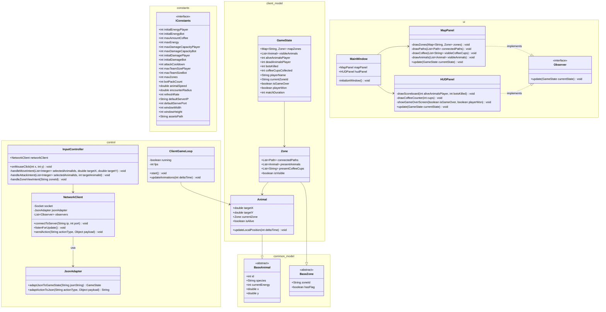

Spec client - Caso 2 POO

Constants (package constants)

	interface IConstants // Centraliza los valores fijos y parametros configurables

    		+ int initialEnergyPlayer = 20 // Energia inicial de cada animal perteneciente al pack de un jugador
		+ int initialEnergyBot = 10 // Energia inicial de cada animal perteneciente a un pack bot
		+ int maxAmountCoffee = 10 // Cantidad total de tazas de cafe disponibles en la partida
		+ int maxEnergy = 20 // Energia maxima que puede alcanzar un animal del pack de un jugador
		+ int maxDamageCapacityPlayer = 12 // Dano maximo teorico del pack de un jugador dano inicial 2 + 10 tazas
		+ int maxDamageCapacityBot = 1 // Dano del pack bot que no aumenta mediante las tazas de cafe
		+ int initialDamagePlayer = 2 // Dano inicial compartido por los animales del pack de un jugador
		+ int initialDamageBot = 1 // Dano inicial compartido por los animales de un pack bot
		+ int attackCooldown = 1000 // Tiempo minimo en milisegundos entre ataques consecutivos de un animal
		+ int maxTeamSizePlayer = 10 // Cantidad de animales que conforman el pack de un jugador
		+ int maxTeamSizeBot = 4 // Cantidad de animales que conforman cada pack bot
		+ int maxZones = 12 // Cantidad total de zonas que conforman el mapa
		+ int botPackCount = 5 // Cantidad de packs bot presentes en la partida
		+ double animalSpeed // Velocidad constante utilizada para representar el movimiento de los animales
		+ double encounterRadius // Radio utilizado para determinar cuando dos animales se encuentran
		+ int refreshRate // Frecuencia de actualizacion visual del cliente
		+ String defaultServerIP = "localhost" // Direccion IP utilizada por defecto para conectarse al servidor
		+ int defaultServerPort = 8080 // Puerto utilizado por defecto para establecer la conexion con el servidor
		+ int windowWidth = 1280 // Ancho de la ventana del juego en pixeles
		+ int windowHeight = 720 // Alto de la ventana del juego en pixeles
		+ String assetsPath = "/assets/images/" // Ruta base donde se encuentran los recursos graficos del juego

Common (package common.model) // Libreria compartida importada por el Cliente y el Servidor

	abstract class BaseAnimal // Contiene los atributos que tanto cliente como servidor comparten

		+ int id // Identificador unico del animal
		+ String species // Especie del animal
		+ int currentEnergy // Energia actual del animal
		+ double x // Posicion horizontal actual
		+ double y // Posicion vertical actual

	abstract class BaseZone // Atributos topologicos basicos compartidos por ambas partes

		+ String zoneId // Identificador unico de la zona del mapa
		+ boolean hasFlag // Indica si existe una bandera en esta zona

Model (package client.model) // Paquete del modelo especifico para el cliente

	class Animal extends common.model.BaseAnimal // Hereda id, species, currentEnergy, x, y del common

		+ double targetX // Destino horizontal para interpolar el movimiento localmente y ahorrar mensajes
		+ double targetY // Destino vertical para interpolar el movimiento localmente y ahorrar mensajes
		+ Zone currentZone // Referencia visual de la zona en la que se encuentra el animal
		+ boolean isAlive // Indica si el animal continua vivo segun el estado recibido del servidor
		+ void updateLocalPosition(int deltaTime) // Interpola la posicion hacia el target de forma autonoma

	class Zone extends common.model.BaseZone // Hereda zoneId y hasFlag del common

		+ List<Path> connectedPaths // Caminos visuales que conectan esta zona con otras
		+ List<Animal> presentAnimals // Animales actualmente contenidos dentro de esta zona visualmente
		+ List<String> presentCoffeeCups // Tazas de cafe contenidas dentro de esta zona visualmente
		+ boolean isVisible // Indica si la zona puede ser mostrada actualmente al jugador

	class GameState // Patron: Sujeto en Observer. Representa el estado global de la partida

		+ Map<String, Zone> mapZones // Contiene las zonas conocidas del mapa organizadas jerarquicamente
		+ List<Animal> visibleAnimals // Animales que el servidor permite visualizar al jugador
		+ int aliveAnimalsPlayer // Cantidad de animales vivos pertenecientes al jugador
		+ int deadAnimalsPlayer // Cantidad de animales eliminados del pack del jugador
		+ int botsKilled // Cantidad de animales pertenecientes a packs bot eliminados por el jugador
		+ int coffeeCupsCollected // Cantidad de tazas de cafe consumidas por el jugador
		+ String playerName // Nickname del jugador
		+ String currentZoneId // Identificador de la zona actualmente seleccionada para visualizar
		+ boolean isGameOver // Indica si la partida ha terminado
		+ boolean playerWon // Indica si el jugador obtuvo la victoria cuando la partida finalizo
		+ int matchDuration // Duracion de la partida recibida al finalizar el juego

UI Layer (package ui) // Paquete encargado de la interfaz de usuario del cliente

	interface Observer // Patron: Observer. Interfaz para recibir actualizaciones del modelo

		+ void update(GameState currentState) // Recibe una actualizacion del estado del juego para refrescar la interfaz

	class MainWindow // Ventana principal del juego

		+ MapPanel mapPanel // Panel encargado de representar visualmente el mapa y sus elementos
		+ HUDPanel hudPanel // Panel encargado de mostrar informacion de la partida
		- void initializeWindow() // Configura la ventana utilizando las constantes de tamaño definidas
	
	class MapPanel implements Observer // Panel que dibuja el mapa y actualiza su vista

		- void drawZones(Map<String, Zone> zones) // Dibuja las zonas visibles y sus contenidos internos
		- void drawPaths(List<Path> connectedPaths) // Dibuja los caminos que conectan las zonas
		- void drawCoffee(List<String> visibleCoffeeCups) // Dibuja las tazas de cafe visibles en sus posiciones
		- void drawAnimals(List<Animal> visibleAnimals) // Dibuja los animales interpolados en sus posiciones
		+ void update(GameState currentState) // Actualiza la representacion visual utilizando el estado recibido

	class HUDPanel implements Observer // Panel que muestra las estadisticas y estado del jugador

		- void drawScoreboard(int aliveAnimalsPlayer, int botsKilled) // Muestra informacion relacionada con los animales
		- void drawCoffeeCounter(int cups) // Muestra la cantidad de tazas de cafe recolectadas
		- void showGameOverScreen(boolean isGameOver, boolean playerWon) // Muestra el resultado de la partida
		+ void update(GameState currentState) // Actualiza la informacion del HUD en base al nuevo estado

Control Layer (package control) // Paquete encargado del control y la comunicacion del cliente

	class JsonAdapter // PATRON: Adapter. Hace que la interfaz incompatible de JSON funcione con objetos Java

		+ GameState adaptJsonToGameState(String jsonString) // Convierte un string JSON en un objeto GameState utilizable
		+ String adaptActionToJson(String actionType, Object payload) // Convierte una accion y su contenido a formato JSON

	class NetworkClient // Encargado de la conexion con el servidor

		- Socket socket // Conexion TCP utilizada para comunicarse con el servidor
		- JsonAdapter jsonAdapter // Se apoya en el adapter para procesar y enviar los mensajes
		- List<Observer> observers // Observadores que reciben las actualizaciones del estado del juego
		+ void connectToServer(String ip, int port) // Establece la conexion con el servidor utilizando ip y puerto
		+ void listenForUpdate() // Ejecuta el hilo encargado de recibir mensajes desde el servidor
		+ void sendAction(String actionType, Object payload) // Utiliza el adapter para construir y enviar el mensaje al server

	class InputController // Interpreta los eventos del usuario y los convierte en acciones

		+ NetworkClient networkClient // Instancia utilizada para enviar las intenciones del jugador al servidor
		+ void onMouseClick(int x, int y) // Detecta la posicion donde el jugador realizo un clic
		- void handleMoveIntent(List<Integer> selectedAnimalIds, double targetX, double targetY) // Envia intencion de movimiento
		- void handleAttackIntent(List<Integer> selectedAnimalIds, int targetAnimalId) // Envia intencion de ataque
		- void handleZoneViewIntent(String zoneId) // Solicita cambiar la zona que se desea visualizar en pantalla

	class ClientGameLoop // Bucle de juego local para interpolar animaciones

		- boolean running // Estado de ejecucion del bucle local
		- int fps // Frecuencia de refresco local para animaciones fluidas
		+ void start() // Inicia el bucle de interpolacion visual
		+ void updateAnimations(int deltaTime) // Interpola el movimiento local de los animales hacia su targetX targetY

Diagrama Mermaid:

