Spec base servidor - Caso 2 POO

Constants (package constants)

	interface IConstants // Centraliza los valores fijos y parametros configurables utilizados por el servidor

   		+ int initialEnergyPlayer = 20 // Energia inicial de cada animal perteneciente al pack de un jugador
		+ int initialEnergyBot = 10 // Energia inicial de cada animal perteneciente a un pack bot
   		+ int maxAmountCoffee = 10 // Cantidad total de tazas de cafe disponibles en la partida
   		+ int maxEnergy = 20 // Energia maxima que puede alcanzar un animal del pack de un jugador
   		+ int maxDamageCapacityPlayer = 12 // Daño maximo teorico del pack de un jugador
   		+ int maxDamageCapacityBot = 1 // Daño maximo del pack bot
  		+ int initialDamagePlayer = 2 // Daño inicial compartido por los animales del pack de un jugador
   		+ int initialDamageBot = 1 // Daño inicial compartido por los animales de un pack bot
   		+ int attackCooldown = 1000 // Tiempo minimo en milisegundos entre ataques consecutivos de un animal
   		+ int maxTeamSizePlayer = 10 // Cantidad de animales que conforman el pack de un jugador
   		+ int maxTeamSizeBot = 4 // Cantidad de animales que conforman cada pack bot
   		+ int maxZones = 12 // Cantidad total de zonas que conforman el mapa
   		+ int botPackCount = 5 // Cantidad de packs bot presentes en la partida
   		+ int playerPackCount = 2 // Cantidad de packs pertenecientes a jugadores
   		+ int totalPackCount = 7 // Cantidad total de packs presentes en la partida
   		+ int maxSpecies = 7 // Cantidad total de especies disponibles en la partida
   		+ int matchCodeLength = 4 // Cantidad de caracteres del codigo de una partida
   		+ double animalSpeed // Velocidad constante utilizada para mover los animales
   		+ double encounterRadius // Radio utilizado para determinar cuando dos animales se encuentran
   		+ double flagRadius // Radio utilizado para determinar cuando un animal toca una bandera
   		+ int tickRate // Intervalo utilizado para actualizar el estado de las partidas
   		+ int defaultServerPort = 8080 // Puerto utilizado por defecto para recibir conexiones

Model (package model)

	class AnimalServer // Representa un animal individual dentro de un pack

   		+ int entityId // Identificador unico para cada animal
   		+ String species // Especie seleccionada para el animal
   		+ int healthPoints // Energia actual del animal
   		+ ZoneServer locationNode // Zona actual donde se encuentra el animal
   		+ double x // Posicion horizontal actual del animal
   		+ double y // Posicion vertical actual del animal
   		+ boolean isDefeated // Indica si el animal ha sido eliminado
   		+ int lastAttackTime // Momento del ultimo ataque realizado por el animal
   		+ void takeDamage(int amount) // Resta energia y marca al animal como eliminado cuando llega a cero
   		+ void heal(int amount) // Aumenta la energia sin superar el maximo permitido
   		+ boolean canAttack(int currentTime) // Comprueba si ya paso el tiempo minimo entre ataques
   		+ void movePosition(double deltaTime) // Actualiza la posicion del animal usando velocidad constante

	class PackServer // Representa un pack y sus propiedades compartidas

   		+ String packId // Identificador unico del pack
   		+ String species // Especie seleccionada para el pack
   		+ List<AnimalServer> animals // Animales pertenecientes al pack
   		+ int damageCapacity // Daño compartido por todos los animales del pack
   		+ int botsKilled // Cantidad de bots eliminados por el jugador
   		+ int coffeeCupsCollected // Cantidad de tazas de cafe recolectadas
   		+ void increaseDamage() // Aumenta en uno el daño del pack sin superar el maximo permitido
   		+ void registerCoffee() // Registra una taza consumida y aumenta el daño del pack
   		+ void registerBotKill() // Registra un bot eliminado y aplica el bonus cuando corresponde
   		+ void applyEnergyBonus() // Aumenta en uno la energia de cada animal vivo sin superar el maximo
   		+ int getAliveAnimals() // Retorna la cantidad de animales vivos del pack
   		+ boolean isDefeated() // Indica si todos los animales del pack han sido eliminados

	class Participant // Representa un participante que posee un pack dentro de la partida

   		+ String participantId // Identificador unico del participante
   		+ PackServer pack // Pack asociado al participante
   		+ ZoneServer startingZone // Zona inicial asignada al participante
   		+ boolean isConnected // Indica si el participante permanece conectado
   		+ boolean checkDefeatStatus() // Comprueba si ya no quedan animales vivos en su pack

	class PlayerServer extends Participant // Representa un jugador humano

   		+ String accountName // Nombre o nickname utilizado por el jugador
   		+ String selectedSpecies // Especie seleccionada por el jugador
   		+ ZoneServer flagZone // Zona donde se encuentra la bandera del jugador
   		+ boolean selectSpecies(String species) // Registra la especie seleccionada si aun esta disponible
   		+ void disconnect() // Marca al jugador como desconectado

	class BotServer extends Participant // Representa un pack controlado automaticamente por el servidor

   		+ void disconnect() // Marca al bot como inactivo al finalizar la partida

	class ZoneServer // Representa una zona y un nodo del grafo del mapa

   		+ String nodeId // Identificador logico de la zona
   		+ List<ZoneServer> adjacentNodes // Lista de zonas conectadas por caminos
   		+ boolean hasFlag // Indica si existe una bandera en esta zona
   		+ String flagOwnerId // Identificador del jugador propietario de la bandera
   		+ void addAdjacentNode(ZoneServer zone) // Agrega una zona conectada al nodo actual
   		+ boolean isConnectedTo(ZoneServer zone) // Comprueba si existe conexion directa entre dos zonas

	class CoffeeCup // Representa una taza de cafe colocada sobre un camino

   		+ String cupId // Identificador unico de la taza
   		+ double x // Posicion horizontal de la taza
   		+ double y // Posicion vertical de la taza
   		+ boolean consumed // Indica si la taza ya fue consumida
   		+ boolean isTouchedBy(AnimalServer animal) // Comprueba si un animal toca la taza
   		+ void consume() // Marca la taza como consumida

	class Flag // Representa una bandera perteneciente a un jugador

   		+ String flagId // Identificador unico de la bandera
   		+ String ownerId // Identificador del jugador propietario
   		+ ZoneServer zone // Zona donde se encuentra la bandera
   		+ double x // Posicion horizontal de la bandera
   		+ double y // Posicion vertical de la bandera
   		+ boolean isTouchedBy(AnimalServer animal) // Comprueba si un animal toca la bandera

	class GameState // Representa el estado de la partida que puede enviarse a un jugador

   		+ Map<String, ZoneServer> visibleZones // Zonas que el jugador puede visualizar
   		+ List<AnimalServer> visibleAnimals // Animales que el jugador puede visualizar
   		+ List<CoffeeCup> visibleCoffeeCups // Tazas que el jugador puede visualizar
   		+ int botsKilled // Cantidad de bots eliminados por el jugador
   		+ int coffeeCupsCollected // Cantidad de tazas consumidas por el jugador
   		+ int currentDamageCapacity // Daño actual del pack del jugador
   		+ int matchDuration // Duracion de la partida
   		+ boolean isGameOver // Indica si la partida ha terminado
   		+ boolean playerWon // Indica si el jugador obtuvo la victoria

	class GameSummary // Representa el resumen enviado al finalizar la partida

   		+ String winnerId // Identificador del jugador ganador
   		+ Map<String, Integer> botsEliminated // Cantidad de bots eliminados por cada jugador
   		+ Map<String, Integer> animalsEliminated // Cantidad de animales eliminados de cada pack
   		+ Map<String, Integer> coffeeCupsCollected // Cantidad de tazas consumidas por cada jugador
   		+ int matchDuration // Duracion total de la partida

Logic (package logic)

	class MatchManager // Administra todas las partidas activas del servidor implementa Singleton

   		- static MatchManager instance // Instancia unica del administrador de partidas
   		- ConcurrentHashMap<String, GameSession> activeMatches // Diccionario de partidas indexado por codigo
   		- MatchManager() // Constructor privado que evita crear multiples instancias
   		+ static MatchManager getInstance() // Retorna la instancia unica del administrador
   		+ String createMatch(PlayerServer player1) // Genera un codigo unico de cuatro caracteres y crea una partida
   		+ GameSession joinMatch(String code, PlayerServer player2) // Busca una partida y conecta al segundo jugador
   		+ void removeMatch(String code) // Elimina una partida cuando finaliza
   		+ boolean isValidMatchCode(String code) // Comprueba si el codigo tiene cuatro caracteres alfanumericos

	class GameSession // Administra la logica completa de una partida

   		- String matchCode // Codigo alfanumerico unico de la partida
   		- PlayerServer player1 // Jugador que creo la partida
   		- PlayerServer player2 // Segundo jugador de la partida
   		- List<BotServer> botPacks // Lista con los cinco packs controlados por bots
   		- Map<String, ZoneServer> worldMap // Mapa oficial compuesto por doce zonas
   		- List<CoffeeCup> coffeeCups // Lista con las diez tazas de cafe
   		- List<Flag> flags // Banderas pertenecientes a los dos jugadores
   		- int startTime // Momento en que comienza la partida
   		- int endTime // Momento en que termina la partida
   		- boolean gameOver // Indica si la partida ya termino
   		+ GameSession(String code, PlayerServer player1) // Constructor que inicializa la partida
   		+ void initializeMatch() // Configura el mapa, los packs, las tazas, las banderas y las posiciones iniciales
   		+ void initializePacks() // Crea los dos packs de jugadores y los cinco packs bot
   		+ void assignStartingZones() // Asigna siete zonas diferentes a los siete packs
   		+ void initializeCoffeeCups() // Crea diez tazas y las coloca aleatoriamente sobre los caminos
   		+ void initializeFlags() // Crea las dos banderas en las zonas iniciales de los jugadores
   		+ boolean selectSpecies(PlayerServer player, String species) // Valida y registra la especie elegida por el jugador
   		+ boolean validateMove(AnimalServer animal, double targetX, double targetY) // Valida que el movimiento solicitado sea permitido
   		+ List<ZoneServer> calculateRouteBFS(ZoneServer start, ZoneServer destination) // Calcula la ruta entre zonas utilizando BFS
   		+ void updateMovement(double deltaTime) // Actualiza la posicion de los animales usando velocidad constante
   		+ void processCombat() // Procesa los ataques de jugadores y los ataques automaticos de los bots
   		+ void executeAttack(AnimalServer attacker, AnimalServer target) // Valida el ataque y aplica el daño del pack atacante
   		+ void processBotAttacks() // Permite que los bots ataquen automaticamente a los animales dentro del radio
   		+ void processCoffeeCollection() // Comprueba si algun animal toca una taza y aumenta el daño del pack
   		+ void processEnergyBonus(PlayerServer player) // Comprueba los bots eliminados y aplica el bonus de energia
   		+ GameState generateSnapshot(PlayerServer requestingPlayer) // Genera solo la informacion visible para el jugador
   		- void checkWinCondition() // Comprueba si un animal toca la bandera del oponente
   		- void finishMatch(PlayerServer winner) // Finaliza la partida y prepara el resumen
   		+ GameSummary generateSummary() // Genera el resumen final de la partida
   		+ void update(int deltaTime) // Actualiza movimiento, combate, cafe y condiciones de victoria

	class GameLoop // Ejecuta actualizaciones periodicas de las partidas activas

   		- boolean running // Indica si el ciclo de actualizacion continua activo
   		- int tickRate // Intervalo entre actualizaciones del servidor
   		+ void start() // Inicia el ciclo de actualizacion
   		+ void stop() // Detiene el ciclo de actualizacion
   		+ void updateMatches(int deltaTime) // Actualiza todas las partidas activas

Network (package network)

	class NetworkServer // Administra el servidor TCP y las conexiones de los clientes

   		- ServerSocket serverSocket // Socket principal utilizado para aceptar conexiones
   		- ExecutorService clientPool // Pool de hilos para atender multiples clientes
   		+ void startServer(int port) // Abre el puerto y comienza a aceptar conexiones
   		+ void acceptConnections() // Acepta conexiones y crea un ClientHandler para cada cliente
   		+ void stopServer() // Cierra el servidor y libera los recursos

	class ClientHandler implements Runnable // Atiende la comunicacion con un cliente conectado

   		- Socket playerSocket // Socket exclusivo para la comunicacion con el cliente
   		- PlayerServer player // Jugador asociado a la conexion
   		- GameSession currentSession // Partida en la que participa el jugador
   		- BufferedReader input // Flujo utilizado para recibir mensajes JSON
   		- PrintWriter output // Flujo utilizado para enviar mensajes JSON
   		+ void run() // Escucha y procesa los mensajes recibidos
   		+ void processMessage(String message) // Interpreta el mensaje JSON recibido
   		+ void sendMessage(String type, Object payload) // Envia un mensaje JSON al cliente
   		+ void closeConnection() // Cierra la conexion y sus recursos

	class MessageHandler // Procesa las acciones enviadas por los clientes

   		+ void handleCreateMatch(ClientHandler client, String nickname) // Procesa la solicitud para crear una partida
   		+ void handleJoinMatch(ClientHandler client, String nickname, String code) // Procesa la solicitud para unirse a una partida
   		+ void handleSelectAnimal(ClientHandler client, String species) // Procesa la seleccion de especie
   		+ void handleMoveAnimals(ClientHandler client, List<Integer> animalIds, double targetX, double targetY) // Procesa la intencion de movimiento
   		+ void handleAttack(ClientHandler client, List<Integer> animalIds, int targetAnimalId) // Procesa la intencion de ataque
   		+ void handleViewZone(ClientHandler client, String zoneId) // Procesa la solicitud para visualizar una zona

	class Message // Representa el formato general de los mensajes JSON

   		+ String type // Tipo de mensaje enviado entre cliente y servidor
   		+ Object payload // Informacion asociada al tipo de mensaje

	class JsonManager // Administra la conversion de objetos Java a JSON y de JSON a objetos

	   	+ String toJson(Message message) // Convierte un mensaje Java en una cadena JSON
	   	+ Message fromJson(String json) // Convierte una cadena JSON en un mensaje Java
	  	+ String toJsonObject(Object object) // Convierte un objeto Java en JSON
		+ Object fromJsonObject(String json, Class type) // Convierte un JSON en el tipo de objeto indicado

Diagrama Mermaid:

```mermaid
classDiagram

    %% Package constants
    namespace constants {
        class IConstants {
            <<interface>>
            +int initialEnergyPlayer
            +int initialEnergyBot
            +int maxAmountCoffee
            +int maxEnergy
            +int maxDamageCapacityPlayer
            +int maxDamageCapacityBot
            +int initialDamagePlayer
            +int initialDamageBot
            +int attackCooldown
            +int maxTeamSizePlayer
            +int maxTeamSizeBot
            +int maxZones
            +int botPackCount
            +int playerPackCount
            +int totalPackCount
            +int maxSpecies
            +int matchCodeLength
            +double animalSpeed
            +double encounterRadius
            +double flagRadius
            +int tickRate
            +int defaultServerPort
        }
    }

    %% Package model
    namespace model {
        class AnimalServer {
            +int entityId
            +String species
            +int healthPoints
            +ZoneServer locationNode
            +double x
            +double y
            +boolean isDefeated
            +int lastAttackTime
            +takeDamage(int amount) void
            +heal(int amount) void
            +canAttack(int currentTime) boolean
            +movePosition(double deltaTime) void
        }

        class PackServer {
            +String packId
            +String species
            +List~AnimalServer~ animals
            +int damageCapacity
            +int botsKilled
            +int coffeeCupsCollected
            +increaseDamage() void
            +registerCoffee() void
            +registerBotKill() void
            +applyEnergyBonus() void
            +getAliveAnimals() int
            +isDefeated() boolean
        }

        class Participant {
            +String participantId
            +PackServer pack
            +ZoneServer startingZone
            +boolean isConnected
            +checkDefeatStatus() boolean
        }

        class PlayerServer {
            +String accountName
            +String selectedSpecies
            +ZoneServer flagZone
            +selectSpecies(String species) boolean
            +disconnect() void
        }

        class BotServer {
            +disconnect() void
        }

        class ZoneServer {
            +String nodeId
            +List~ZoneServer~ adjacentNodes
            +boolean hasFlag
            +String flagOwnerId
            +addAdjacentNode(ZoneServer zone) void
            +isConnectedTo(ZoneServer zone) boolean
        }

        class CoffeeCup {
            +String cupId
            +double x
            +double y
            +boolean consumed
            +isTouchedBy(AnimalServer animal) boolean
            +consume() void
        }

        class Flag {
            +String flagId
            +String ownerId
            +ZoneServer zone
            +double x
            +double y
            +isTouchedBy(AnimalServer animal) boolean
        }

        class GameState {
            +Map~String, ZoneServer~ visibleZones
            +List~AnimalServer~ visibleAnimals
            +List~CoffeeCup~ visibleCoffeeCups
            +int botsKilled
            +int coffeeCupsCollected
            +int currentDamageCapacity
            +int matchDuration
            +boolean isGameOver
            +boolean playerWon
        }

        class GameSummary {
            +String winnerId
            +Map~String, Integer~ botsEliminated
            +Map~String, Integer~ animalsEliminated
            +Map~String, Integer~ coffeeCupsCollected
            +int matchDuration
        }
    }

    %% Package logic
    namespace logic {
        class MatchManager {
            -MatchManager instance$
            -ConcurrentHashMap~String, GameSession~ activeMatches
            -MatchManager()
            +getInstance()$ MatchManager
            +createMatch(PlayerServer player1) String
            +joinMatch(String code, PlayerServer player2) GameSession
            +removeMatch(String code) void
            +isValidMatchCode(String code) boolean
        }

        class GameSession {
            -String matchCode
            -PlayerServer player1
            -PlayerServer player2
            -List~BotServer~ botPacks
            -Map~String, ZoneServer~ worldMap
            -List~CoffeeCup~ coffeeCups
            -List~Flag~ flags
            -int startTime
            -int endTime
            -boolean gameOver
            +GameSession(String code, PlayerServer player1)
            +initializeMatch() void
            +initializePacks() void
            +assignStartingZones() void
            +initializeCoffeeCups() void
            +initializeFlags() void
            +selectSpecies(PlayerServer player, String species) boolean
            +validateMove(AnimalServer animal, double targetX, double targetY) boolean
            +calculateRouteBFS(ZoneServer start, ZoneServer destination) List~ZoneServer~
            +updateMovement(double deltaTime) void
            +processCombat() void
            +executeAttack(AnimalServer attacker, AnimalServer target) void
            +processBotAttacks() void
            +processCoffeeCollection() void
            +processEnergyBonus(PlayerServer player) void
            +generateSnapshot(PlayerServer requestingPlayer) GameState
            -checkWinCondition() void
            -finishMatch(PlayerServer winner) void
            +generateSummary() GameSummary
            +update(int deltaTime) void
        }

        class GameLoop {
            -boolean running
            -int tickRate
            +start() void
            +stop() void
            +updateMatches(int deltaTime) void
        }
    }

    %% Package network
    namespace network {
        class NetworkServer {
            -ServerSocket serverSocket
            -ExecutorService clientPool
            +startServer(int port) void
            +acceptConnections() void
            +stopServer() void
        }

        class ClientHandler {
            -Socket playerSocket
            -PlayerServer player
            -GameSession currentSession
            -BufferedReader input
            -PrintWriter output
            +run() void
            +processMessage(String message) void
            +sendMessage(String type, Object payload) void
            +closeConnection() void
        }

        class MessageHandler {
            +handleCreateMatch(ClientHandler client, String nickname) void
            +handleJoinMatch(ClientHandler client, String nickname, String code) void
            +handleSelectAnimal(ClientHandler client, String species) void
            +handleMoveAnimals(ClientHandler client, List~Integer~ animalIds, double targetX, double targetY) void
            +handleAttack(ClientHandler client, List~Integer~ animalIds, int targetAnimalId) void
            +handleViewZone(ClientHandler client, String zoneId) void
        }

        class Message {
            +String type
            +Object payload
        }

        class JsonManager {
            +toJson(Message message) String
            +fromJson(String json) Message
            +toJsonObject(Object object) String
            +fromJsonObject(String json, Class type) Object
        }
    }

    %% Relaciones / Herencia
    PlayerServer --|> Participant
    BotServer --|> Participant
    
    %% Asociaciones Model
    Participant --> PackServer : pack
    Participant --> ZoneServer : startingZone
    PlayerServer --> ZoneServer : flagZone
    PackServer --> AnimalServer : animals
    AnimalServer --> ZoneServer : locationNode
    ZoneServer --> ZoneServer : adjacentNodes
    Flag --> ZoneServer : zone
    
    %% Asociaciones Logic
    MatchManager --> GameSession : activeMatches
    GameSession --> PlayerServer : player1, player2
    GameSession --> BotServer : botPacks
    GameSession --> ZoneServer : worldMap
    GameSession --> CoffeeCup : coffeeCups
    GameSession --> Flag : flags
    
    %% Asociaciones Network
    NetworkServer --> ClientHandler : clientPool
    ClientHandler --> PlayerServer : player
    ClientHandler --> GameSession : currentSession
```

