Spec server - Caso 2 POO

Constants (package constants)

	interface IConstants // Centraliza los valores fijos compartidos mediante libreria common

   		+ int initialEnergyPlayer = 20 // Energia inicial de cada animal perteneciente al pack de un jugador
		+ int initialEnergyBot = 10 // Energia inicial de cada animal perteneciente a un pack bot
   		+ int maxAmountCoffee = 10 // Cantidad total de tazas de cafe disponibles en la partida
   		+ int maxEnergy = 20 // Energia maxima que puede alcanzar un animal del pack de un jugador
   		+ int maxDamageCapacityPlayer = 12 // Dano maximo teorico del pack de un jugador
   		+ int initialDamagePlayer = 2 // Dano inicial compartido por los animales del pack de un jugador
   		+ int initialDamageBot = 1 // Dano inicial compartido por los animales de un pack bot
   		+ int attackCooldown = 1000 // Tiempo minimo en milisegundos entre ataques consecutivos de un animal
   		+ int maxTeamSizePlayer = 10 // Cantidad de animales que conforman el pack de un jugador
   		+ int maxZones = 12 // Cantidad total de zonas que conforman el mapa
   		+ int botPackCount = 5 // Cantidad de packs bot presentes en la partida
   		+ double animalSpeed // Velocidad constante utilizada para mover los animales
   		+ double encounterRadius // Radio utilizado para determinar cuando dos animales se encuentran
   		+ double flagRadius // Radio utilizado para determinar cuando un animal toca una bandera
   		+ int tickRate // Intervalo utilizado para actualizar el estado de las partidas
   		+ int defaultServerPort = 8080 // Puerto utilizado por defecto para recibir conexiones

Common (package common.model) // Libreria compartida importada por el Cliente y el Servidor

	abstract class BaseAnimal // Contiene los atributos que tanto cliente como servidor comparten

		+ int id // Identificador unico del animal
		+ String species // Especie del animal
		+ int currentEnergy // Energia actual del animal
		+ double x // Posicion horizontal actual
		+ double y // Posicion vertical actual

	abstract class BaseZone // Atributos topologicos basicos compartidos por ambas partes

		+ String zoneId // Identificador logico unico de la zona del mapa
		+ boolean hasFlag // Indica si existe una bandera en esta zona

Model (package server.model) // Paquete del modelo especifico para la logica del servidor

	class Animal extends common.model.BaseAnimal // Hereda atributos base de la libreria comun

   		+ double targetX // Destino horizontal actual real al que se dirige
   		+ double targetY // Destino vertical actual real al que se dirige
   		+ boolean isDefeated // Indica si el animal ha sido eliminado en combate
   		+ int lastAttackTime // Momento en milisegundos del ultimo ataque
   		+ void takeDamage(int amount) // Resta energia y marca eliminado si llega a cero
   		+ void heal(int amount) // Aumenta la energia sin superar el maximo permitido
   		+ boolean canAttack(int currentTime) // Comprueba si el cooldown permite realizar otro ataque
   		+ void movePosition(double deltaTime) // Calcula el avance oficial de las coordenadas hacia el destino

	class Pack // Representa una agrupacion de animales con estadisticas compartidas

   		+ String packId // Identificador unico de la manada o pack
   		+ String species // Especie seleccionada para todos los miembros
   		+ List<Animal> animals // Lista de animales pertenecientes al pack
   		+ int damageCapacity // Dano base compartido por todo el pack
   		+ int botsKilled // Cantidad de bots eliminados por el pack
   		+ void increaseDamage() // Aumenta el dano total del pack al recolectar cafe
   		+ void applyEnergyBonus() // Aplica bonus de energia a los animales vivos por bots eliminados
   		+ boolean isDefeated() // Comprueba si todos los miembros del pack han sido aniquilados

	class Participant // Entidad abstracta que engloba a jugadores y bots en la partida

   		+ String participantId // Identificador unico del participante
   		+ Pack pack // Referencia al pack de animales asociado
   		+ boolean isConnected // Estado de conexion en la partida actual

	class Player extends Participant // Representa un jugador humano conectado

   		+ String accountName // Nickname del jugador ingresado al conectar
   		+ String selectedSpecies // Nombre de la especie seleccionada
   		+ boolean selectSpecies(String species) // Registra y valida la especie en el sistema

	class Bot extends Participant // Representa a la inteligencia automatizada sin conexion real

		+ void updateAI(int deltaTime) // Bucle interno del bot para procesar su logica autonoma por tick
		+ void searchTargets(Zone currentZone) // Identifica animales enemigos cercanos en su misma zona
		+ void autoMove() // Calcula y asigna rutas de patrullaje o persecucion de forma independiente

	class Zone extends common.model.BaseZone // Hereda id y bandera de la libreria comun

   		+ List<Zone> adjacentNodes // Conexiones reales a otras zonas para usarse en el algoritmo BFS
   		+ List<Animal> entitiesInside // Animales que oficialmente estan pisando esta zona en el server
   		+ List<CoffeeCup> cupsInside // Tazas de cafe reales generadas en esta zona
   		+ Flag flag // Objeto bandera asignado a esta zona si corresponde
   		+ void addEntity(Animal animal) // Ingresa oficialmente un animal a la zona logica
   		+ void removeEntity(Animal animal) // Remueve un animal que acaba de salir de la zona

	class CoffeeCup // Elemento interactivo en el mapa

   		+ String cupId // ID de la taza
   		+ double x // Coordenada X de la taza
   		+ double y // Coordenada Y de la taza
   		+ boolean consumed // Indica si ya fue tomada por un animal

	class Flag // Objetivo de la partida para los jugadores

   		+ String flagId // ID de la bandera
   		+ String ownerId // ID del jugador propietario de esta bandera
   		+ double x // Coordenada X de la bandera
   		+ double y // Coordenada Y de la bandera

	class GameState // Estructura de datos generada para enviarse como snapshot al cliente

   		+ Map<String, Zone> visibleZones // Zonas visibles filtradas y autorizadas por el servidor
   		+ int matchDuration // Tiempo actual transcurrido en la partida

Logic (package logic) // Paquete de control y logica principal del servidor

	interface IParticipantFactory // Patron: Abstract Factory. Crea familias de objetos relacionados sin depender de clases concretas

		+ Participant createParticipant(String id, String name) // Instancia el tipo de participante adecuado
		+ Pack createPack(String packId, String species) // Crea y configura el pack para el participante
		+ List<Animal> createAnimals(int count, int initialEnergy) // Genera la cantidad de animales indicada con su energia

	class PlayerFactory implements IParticipantFactory // Fabrica concreta encargada de instanciar familias para Jugadores

		+ Participant createParticipant(String id, String name) // Crea y retorna un Player
		+ Pack createPack(String packId, String species) // Crea un pack inicializado para el jugador
		+ List<Animal> createAnimals(int count, int initialEnergy) // Crea la lista de animales para el jugador

	class BotFactory implements IParticipantFactory // Fabrica concreta encargada de instanciar familias para Bots autonomos

		+ Participant createParticipant(String id, String name) // Crea y retorna un Bot
		+ Pack createPack(String packId, String species) // Crea un pack con los atributos limitados de un bot
		+ List<Animal> createAnimals(int count, int initialEnergy) // Crea la lista reducida de animales bot

	class GameSessionBuilder // Patron: Builder. Construye el objeto complejo GameSession paso a paso encapsulando la creacion

		- GameSession session // Instancia de la sesion en proceso de construccion
		+ void reset(String matchCode) // Inicializa una nueva sesion vacia con su codigo
		+ void buildPlayers(Player p1, Player p2) // Ensambla los jugadores dentro de la sesion
		+ void buildBots(IParticipantFactory botFactory) // Construye y asigna todos los bots requeridos
		+ void buildMap(MapManager mapManager) // Configura el manager del mapa en la sesion
		+ void buildItems() // Genera las tazas y banderas en sus respectivas posiciones iniciales
		+ GameSession getResult() // Retorna el objeto GameSession completamente ensamblado

	class MatchManager // Patron: Singleton. Garantiza que exista solo una instancia de la clase administradora en todo el servidor

   		- static MatchManager instance // Instancia estatica unica
   		- ConcurrentHashMap<String, GameSession> activeMatches // Diccionario thread safe de partidas activas
   		- MatchManager() // Constructor privado para evitar instanciacion externa
   		+ static MatchManager getInstance() // Retorna la instancia global o la crea si no existe
   		+ String createMatch(Player player1) // Utiliza el builder para instanciar un room nuevo
   		+ GameSession joinMatch(String code, Player player2) // Busca la sesion y agrega al segundo jugador
   		+ void removeMatch(String code) // Elimina la sesion de memoria al finalizar

	class GameSession // Room que encapsula todo el estado de una partida aislada

   		- String matchCode // ID de cuatro caracteres del Room
   		- Player player1 // Primer jugador de la partida
   		- Player player2 // Segundo jugador de la partida
   		- List<Bot> bots // Lista de participantes autonomos controlados por IA
   		- MapManager mapManager // Delegado para calculos topologicos
   		- CombatManager combatManager // Delegado para procesar combates
   		- boolean gameOver // Bandera de fin de juego
   		+ GameSession(String code) // Constructor base del room
   		+ void setPlayers(Player p1, Player p2) // Setter llamado por el Builder para asignar jugadores
   		+ void setBots(List<Bot> botsList) // Setter llamado por el Builder para inyectar los bots
   		+ void update(int deltaTime) // Bucle central de la sesion que actualiza su estado interno
   		+ void broadcastAction(String action, Object payload) // Notifica estado a los sockets de los jugadores

	class MapManager // Modulo delegado para el manejo espacial del juego

		- Map<String, Zone> worldMap // Topologia del mapa del juego
		+ void assignStartingZones(List<Participant> participants) // Distribuye a los packs en las zonas de inicio
		+ List<Zone> calculateRouteBFS(Zone start, Zone destination) // Ejecuta busqueda de ruta mas corta
		+ void transferEntity(Animal animal, Zone from, Zone to) // Intercambia logicamente al animal de zona
		
	class CombatManager // Modulo delegado para el calculo de colisiones y batallas

		+ void processCombat(List<Zone> activeZones) // Itera las zonas buscando enemigos en rango
		+ void executeAttack(Animal attacker, Animal target, Pack attackerPack) // Ejecuta el descuento de energia y cooldown
		+ void validateDeath(Animal target) // Verifica si el animal murio tras el ataque

	class GameLoop // Hilo maestro de actualizacion autonoma del motor

   		- boolean running // Bandera de estado del hilo maestro
   		- int tickRate // Cantidad de milisegundos entre ticks del servidor
   		+ void start() // Levanta el hilo de procesamiento continuo
   		+ void updateMatches(int deltaTime) // Itera sobre las partidas de MatchManager llamando a su update local

Network (package network) // Paquete de integracion y conectividad de red

	class NetworkServer // Servidor socket encargado de aceptar los clientes

   		- ServerSocket serverSocket // Socket maestro que aguarda conexiones entrantes
   		- ExecutorService clientPool // Pool de hilos para aislar cada conexion cliente
   		+ void startServer(int port) // Abre el puerto definido y pone a la escucha el hilo
   		+ void acceptConnections() // Espera conexiones y genera los ClientHandlers respectivos

	class ClientHandler implements Runnable // Hilo asignado exclusivamente para atender a un cliente conectado

   		- Socket playerSocket // Conexion fisica TCP con el cliente
   		- String currentRoomCode // Codigo de sesion del room en el que se encuentra el jugador
   		- MessageRouterServer router // Enrutador instanciado para redirigir las peticiones parseadas
   		+ void run() // Bucle de lectura de entrada del socket mientras este vivo
   		+ void sendMessage(String type, Object payload) // Formatea en JSON y brinda el string al socket de salida

	class MessageRouterServer // Modulo intermedio que decide a que handler derivar la instruccion

		- MessageHandler handler // Referencia al procesador de mensajes
		+ void routeMessage(ClientHandler client, String currentRoomCode, String jsonMessage) // Lee tipo y envia a metodo adecuado

	class MessageHandler // Ejecutor final de la logica inyectada por el cliente sobre su room

   		+ void handleMoveAnimals(GameSession room, Player player, List<Integer> animalIds, double targetX, double targetY) // Aplica movimiento
   		+ void handleAttack(GameSession room, Player player, List<Integer> animalIds, int targetAnimalId) // Inicia orden de ataque

Diagrama Mermaid:

```mermaid
classDiagram

    namespace constants {
        class IConstants {
            <<interface>>
            +int initialEnergyPlayer
            +int initialEnergyBot
            +int maxAmountCoffee
            +int maxEnergy
            +int maxDamageCapacityPlayer
            +int initialDamagePlayer
            +int initialDamageBot
            +int attackCooldown
            +int maxTeamSizePlayer
            +int maxZones
            +int botPackCount
            +double animalSpeed
            +double encounterRadius
            +double flagRadius
            +int tickRate
            +int defaultServerPort
        }
    }

    namespace common_model {
        class BaseAnimal {
            <<abstract>>
            +int id
            +String species
            +int currentEnergy
            +double x
            +double y
        }
        class BaseZone {
            <<abstract>>
            +String zoneId
            +boolean hasFlag
        }
    }

    namespace server_model {
        class Animal {
            +double targetX
            +double targetY
            +boolean isDefeated
            +int lastAttackTime
            +takeDamage(int amount) void
            +heal(int amount) void
            +canAttack(int currentTime) boolean
            +movePosition(double deltaTime) void
        }
        class Pack {
            +String packId
            +String species
            +List~Animal~ animals
            +int damageCapacity
            +int botsKilled
            +increaseDamage() void
            +applyEnergyBonus() void
            +isDefeated() boolean
        }
        class Participant {
            +String participantId
            +Pack pack
            +boolean isConnected
        }
        class Player {
            +String accountName
            +String selectedSpecies
            +selectSpecies(String species) boolean
        }
        class Bot {
            +updateAI(int deltaTime) void
            +searchTargets(Zone currentZone) void
            +autoMove() void
        }
        class Zone {
            +List~Zone~ adjacentNodes
            +List~Animal~ entitiesInside
            +List~CoffeeCup~ cupsInside
            +Flag flag
            +addEntity(Animal animal) void
            +removeEntity(Animal animal) void
        }
        class Flag {
            +String flagId
            +String ownerId
            +double x
            +double y
        }
        class CoffeeCup {
            +String cupId
            +double x
            +double y
            +boolean consumed
        }
        class GameState {
            +Map~String, Zone~ visibleZones
            +int matchDuration
        }
    }

    namespace logic {
        class IParticipantFactory {
            <<interface>>
            +createParticipant(String id, String name) Participant
            +createPack(String packId, String species) Pack
            +createAnimals(int count, int initialEnergy) List~Animal~
        }
        class PlayerFactory {
            +createParticipant(String id, String name) Participant
            +createPack(String packId, String species) Pack
            +createAnimals(int count, int initialEnergy) List~Animal~
        }
        class BotFactory {
            +createParticipant(String id, String name) Participant
            +createPack(String packId, String species) Pack
            +createAnimals(int count, int initialEnergy) List~Animal~
        }
        class GameSessionBuilder {
            -GameSession session
            +reset(String matchCode) void
            +buildPlayers(Player p1, Player p2) void
            +buildBots(IParticipantFactory botFactory) void
            +buildMap(MapManager mapManager) void
            +buildItems() void
            +getResult() GameSession
        }
        class MatchManager {
            -MatchManager instance$
            -ConcurrentHashMap~String, GameSession~ activeMatches
            -MatchManager()
            +getInstance()$ MatchManager
            +createMatch(Player player1) String
            +joinMatch(String code, Player player2) GameSession
            +removeMatch(String code) void
        }
        class GameSession {
            -String matchCode
            -Player player1
            -Player player2
            -List~Bot~ bots
            -MapManager mapManager
            -CombatManager combatManager
            -boolean gameOver
            +GameSession(String code)
            +setPlayers(Player p1, Player p2) void
            +setBots(List~Bot~ botsList) void
            +update(int deltaTime) void
            +broadcastAction(String action, Object payload) void
        }
        class MapManager {
            -Map~String, Zone~ worldMap
            +assignStartingZones(List~Participant~ participants) void
            +calculateRouteBFS(Zone start, Zone destination) List~Zone~
            +transferEntity(Animal animal, Zone from, Zone to) void
        }
        class CombatManager {
            +processCombat(List~Zone~ activeZones) void
            +executeAttack(Animal attacker, Animal target, Pack attackerPack) void
            +validateDeath(Animal target) void
        }
        class GameLoop {
            -boolean running
            -int tickRate
            +start() void
            +updateMatches(int deltaTime) void
        }
    }

    namespace network {
        class NetworkServer {
            -ServerSocket serverSocket
            -ExecutorService clientPool
            +startServer(int port) void
            +acceptConnections() void
        }
        class ClientHandler {
            -Socket playerSocket
            -String currentRoomCode
            -MessageRouterServer router
            +run() void
            +sendMessage(String type, Object payload) void
        }
        class MessageRouterServer {
            -MessageHandler handler
            +routeMessage(ClientHandler client, String currentRoomCode, String jsonMessage) void
        }
        class MessageHandler {
            +handleMoveAnimals(GameSession room, Player player, List~Integer~ animalIds, double targetX, double targetY) void
            +handleAttack(GameSession room, Player player, List~Integer~ animalIds, int targetAnimalId) void
        }
    }

    Animal --|> BaseAnimal
    Zone --|> BaseZone
    Player --|> Participant
    Bot --|> Participant
    Participant --> Pack : pack
    Pack --> Animal : animals
    Zone --> Animal
    Zone --> CoffeeCup
    Zone --> Flag
    
    PlayerFactory ..|> IParticipantFactory : implements
    BotFactory ..|> IParticipantFactory : implements
    
    MatchManager --> GameSessionBuilder : uses to create session
    GameSessionBuilder --> GameSession : builds
    GameSession --> MapManager
    GameSession --> CombatManager
    GameSession --> Player
    GameSession --> Bot
    
    ClientHandler --> MessageRouterServer
    MessageRouterServer --> MessageHandler
    MessageHandler --> GameSession
```

